# Modstead — Safe Mod Manager and Career Mode for Microsoft Flight Simulator 2024 & 2020

**English** · [Türkçe](README.tr.md)

<p align="center">
  <a href="https://buymeacoffee.com/azorkai">
    <picture>
      <source media="(prefers-color-scheme: dark)" srcset="docs/assets/support-en-dark.svg">
      
    </picture>
  </a>
</p>

**Modstead** is a free, open-source mod manager for Windows for **Microsoft Flight Simulator 2020 & 2024**. Every
download and archive goes through a security pipeline (allowlisted sources, hash verification, safe extraction, content
checks and a Microsoft Defender scan), and nothing is installed until you review and approve it.

Modstead also includes a free **[MSFS 2024 career mode](#msfs-2024-career-mode)**: a job
board, pilot licences and checkrides, automatic flight setup, flight tracking over SimConnect, a logbook, your own
aircraft, an in-sim toolbar panel and a career page in the MSFS 2024 main menu.

Built with [Tauri 2](https://tauri.app) (Rust) and React 19. Licensed under GPL-3.0.

> **Status:** early development (v0.2.0). Windows 10/11 only.

## Download

**[Download Modstead for Windows](https://github.com/azorkai/modstead/releases/latest/download/Modstead-setup-x64.exe)**
(Windows 10/11, x64) · [All releases](https://github.com/azorkai/modstead/releases) ·
[Website](https://azorkai.github.io/modstead/) · [☕ Buy me a coffee](https://buymeacoffee.com/azorkai)

The installer installs Modstead for the current user and needs no administrator rights. It is not code-signed yet, so
Windows SmartScreen may show "Windows protected your PC"; choose **More info → Run anyway**. Each release lists the
installer's SHA-256 checksum in `SHA256SUMS.txt`; compare it with the output of
`(Get-FileHash .\Modstead-setup-x64.exe -Algorithm SHA256).Hash` in PowerShell
([other ways](docs/RELEASING.md#verify-a-download)). To build Modstead yourself, see
[Building from source](#building-from-source).

Modstead keeps itself up to date: it checks for new releases in the background, verifies the signature of each download
and installs it only when you click **Restart**, never while the sim is open or a career flight is being tracked. You
can turn the check off in Settings → Updates. Version 0.1.0 has no updater; install a newer release over it once.

## What Modstead does for MSFS

| Sim | What Modstead does |
|---|---|
| **Microsoft Flight Simulator 2020 & 2024** | One mod library shared by both sims; mods are enabled per sim with junctions into the Community folder (no admin rights needed). Profiles, file and ICAO conflict detection, `exe.xml` add-on management, readiness checks (Content.xml, path length), a GitHub catalog (FlyByWire, Headwind…), an in-app mod browser and a built-in [career mode](#msfs-2024-career-mode). |

MSFS 2024 and 2020 are detected automatically on **Steam** and the **Microsoft Store / Xbox app**; a sim in another
folder can be added by choosing its folder.

## MSFS 2024 career mode

<p align="center">
  
</p>

Modstead includes a free, open-source **career mode for Microsoft Flight Simulator 2024** that also works with
MSFS 2020. Start as a student pilot, take jobs from a job board, earn licences through checkrides and buy your own
aircraft. Every flight is prepared in the sim, tracked over SimConnect and written to your logbook, and every rule, fee
and penalty is documented.

- **Job board** at your current airport: cargo, passengers, charter, aircraft ferry, bush flights, air ambulance and
  airline flights, filtered by your licences and reputation, with a route map. Fly for an operator, or on your own
  account after the CPL.
- **Career paths:** choose airline, cargo, bush, air ambulance, charter or aerial work at the start, or stay a freelance
  pilot. Start from scratch or as an experienced pilot with the licences and hours of that path, climb three ranks with
  bonus pay, and change path later without losing anything.
- **Add-on aircraft:** mod aircraft from your library and Community folders (Fenix, PMDG, iniBuilds…) are listed with
  their liveries even while the sim is closed. The class comes from the ICAO type code, and aircraft that handle payload
  and fuel in their own EFB are detected; you can override both per aircraft.
- **Weather and time scenarios:** jobs can be at night, at dawn, in snow, rain or a storm, or in clear skies; the job
  board shows which, and the flight starts in the sim with that weather and time.
- **Flight deck:** a live map (offline chart or satellite imagery) with the flight's numbers in a separate window, or on
  a tablet or phone on your home network (off by default, protected with a key and a QR code).
- **Automatic flight setup:** Modstead starts the sim if needed, picks a suitable parking spot from the sim's own
  airport data (or puts you on the runway with the engines running), writes the flight and route plan (`.FLT`/`.PLN`,
  the route goes into the sim's GPS), moves the aircraft and loads the payload. Tested in the real MSFS 2024.
- **Flight tracking and score:** flight phases, landing rate and G at touchdown, bounces, overspeed, stall and flap
  warnings, and cheat detection (slew, teleport, refuelling in the air). The score earns XP and reputation; money only
  follows real events such as delays, fuel, rent and damage.
- **Licences and ratings:** SPL → PPL → CPL, multi-engine, instrument, helicopter, jet, ATPL and narrowbody/widebody type
  ratings, each with hours, a level, a fee and a checkride.
- **Logbook** with the flown track, landing data, deductions and pay for every flight; **hangar and finance** with
  aircraft purchases, maintenance and a loan.
- **In-sim toolbar panel** for MSFS 2020 and 2024 with the route, phase, remaining distance, ETA, score and pay, also in
  full screen and VR.
- **Career page in the MSFS 2024 main menu:** a *Modstead Career* tile next to the sim's own tiles opens a full-screen
  page where you take a job, pick an aircraft (with real photos) and start the flight without leaving the sim. Mouse,
  keyboard and controller work as on the sim's own pages.
- **Realism without the grind:** stabilised-approach gate, touchdown point and centreline, tail strike and weight
  limits, a dispatch release (EASA fuel policy, weights, alternate, runway and density altitude), real METAR weather,
  passenger comfort and sensitive cargo, pilot currency, medical and flight duty, a maintenance programme with
  insurance, regional fuel prices and navigation charges, aerial work (tours, skydiving, survey, search and rescue),
  achievements and appeals. The score only drops for safety; procedures only add bonus XP.
- **Free and local:** no subscription, no account and no online server; works offline. SimBrief is one click away.

> **It runs inside Modstead.** The career is not a separate add-on: its data, rules and sim connection live in the
> Modstead app, and the career itself needs nothing inside the sim. The toolbar panel and the main menu tile are optional
> packages that show what Modstead serves on `127.0.0.1`. With Modstead closed, flights are not tracked, the panel shows
> "Modstead not connected" and the tile does not appear.

<table>
  <tr>
    <td width="50%"><br><sub><b>Job board</b> with a route map</sub></td>
    <td width="50%"><br><sub><b>Licences and ratings</b> earned through checkrides</sub></td>
  </tr>
  <tr>
    <td width="50%"><br><sub><b>Logbook</b> with landing rate and grade</sub></td>
    <td width="50%"><br><sub><b>Flight details</b> with the flown track</sub></td>
  </tr>
  <tr>
    <td width="50%"><br><sub><b>Hangar and finance</b></sub></td>
    <td width="50%"><br><sub><b>New pilot</b> (light theme)</sub></td>
  </tr>
</table>

### How it works

1. **Pick a job** from the job board at your airport.
2. **Modstead sets up the flight:** it starts MSFS if needed, places your aircraft at a suitable stand, loads the
   payload and writes a route plan. If the sim does not load the flight by itself, open a free flight at the departure
   airport and press *Move to parking*.
3. **Pass the pre-flight checks** (sim connected, at the departure airport, right aircraft, slew off) and start the
   engines: tracking starts by itself.
4. **Fly and land.** Modstead reads the sim about 10 times a second over SimConnect, scores the flight and writes it to
   your logbook with pay, XP and reputation.

Modstead talks to the sim with its own implementation of the SimConnect network protocol over local TCP, so no
SimConnect.dll is shipped and nothing is injected into the sim. MSFS 2024 opens this port by default; MSFS 2020 needs a
local IPv4 entry in `SimConnect.xml` ([how](games/msfs/CAREER.md#does-it-work-with-msfs-2020)).

<p align="center">
  
</p>

### In-sim toolbar panel

<p align="center">
  
</p>

An optional panel for the MSFS 2020 and 2024 toolbar. It reads values that Modstead writes once a second through
SimConnect; while Modstead is open it also takes its code from Modstead's local server, so a Modstead update reaches the
panel without restarting the sim. Install it from Career → Dashboard → *In-sim panel*; it goes into the Community folder
like any other mod. The image is a browser preview of the panel's own code inside the sim's panel frame with simulated
values, not a capture from the sim. An earlier version was tried in MSFS 2024 and fixed; the current one (0.3.0) has not
been flown with yet.

### Career page in the MSFS 2024 main menu

<p align="center">
  
</p>

An optional *Modstead Career* tile for the MSFS 2024 main menu. It opens a full-screen page with four tabs: the active
job (route strip with runways and elevations, payload, fuel, deadline, aircraft, start at the gate or on the runway, and
the preparation checks), the job board, aircraft choice with photos and the pilot profile (level, reputation, licences,
recent flights). ESC, Space, Q/E and the arrow keys work as on the sim's own pages, and the sim's key bar shows the
page's own shortcuts. Install it from Career → Dashboard; Modstead builds the package from your own sim's menu component
and removes it by itself if a sim update changes that component. Tried in MSFS 2024 1.9.21.0.

<table>
  <tr>
    <td width="50%"><br><sub><b>Job board</b> inside the sim</sub></td>
    <td width="50%"><br><sub><b>Pilot</b> tab inside the sim</sub></td>
  </tr>
</table>

The main menu images were captured in the sim with a sample career and the Turkish interface.

Rules, formulas, licence requirements, the research behind the design and the architecture:
**[MSFS 2024 career mode documentation](games/msfs/CAREER.md)** ([Türkçe](games/msfs/KARIYER.md)). The career mode is in
early development like the rest of Modstead.

## Features

- **One app for every game:** each game keeps its own pages, accent colour and typography inside the same shell.
  The home page shows the status of all games, recent activity and security events.
- **Security pipeline for every install:** downloads come only from allowlisted HTTPS hosts and are verified against the
  source's hash (GitHub SHA-256, Nexus Mods MD5). Archives are extracted into quarantine with protection against
  zip-slip, alternate data streams, device names, symlinks and zip bombs, checked against the game's content rules,
  scanned by Microsoft Defender and optionally looked up on VirusTotal by hash. You get a verdict and a risk score
  before anything is installed.
- **Installers are never run:** `.exe` and `.msi` files are reported, never executed.
- **Nexus Mods "Mod Manager Download":** a single `nxm://` handler routes each link to the right game; the previous
  handler is saved.
- **One account store:** Nexus Mods, VirusTotal and GitHub keys are stored once, in Windows Credential Manager,
  never in plain files.
- **Game-aware safety:** Modstead refuses to write into a game's mod folder while the game is running.
- Turkish and English interface, dark and light themes, command palette (`Ctrl+K`), drag-and-drop archive install.

## How the security pipeline works

```
resolve → download (allowlist, size limit) → verify hash → extract into quarantine
       → content check (game rules) → Microsoft Defender → optional VirusTotal → review dialog → install
```

The interface has no file system, shell or network permissions and runs under a strict Content Security Policy.
Every action goes through a validating Rust command, and paths coming from the interface are locked to their
expected root folder. To report a vulnerability, see [SECURITY.md](SECURITY.md).

## FAQ

### What is Modstead?
Modstead is a Windows desktop mod manager for Microsoft Flight Simulator 2020 and 2024, with a security pipeline for
every install and a free career mode.

### Is Modstead free?
Yes. Modstead is free and open source under the GNU General Public License v3.0.

### Does Modstead have a career mode for MSFS 2024?
Yes. Modstead includes a free career mode for Microsoft Flight Simulator 2024 with a job board, licences and checkrides,
automatic flight setup, flight tracking over SimConnect, a logbook, aircraft ownership, an in-sim toolbar panel and a
career page in the MSFS 2024 main menu. It also works with MSFS 2020 once a local IPv4 SimConnect port is enabled. See the
[career mode documentation](games/msfs/CAREER.md).

### Is the career mode an alternative to OnAir, NeoFly or FSEconomy?
It covers similar ground (jobs, an economy, licences and a logbook) but is free, open source and fully local: no
subscription, no account and no online server, with every formula documented. It has no shared online world or multiplayer
economy. The [career documentation](games/msfs/CAREER.md#research-how-other-msfs-career-add-ons-work) compares the
approaches.

### Is it safe to install mods with Modstead?
Every archive is hash-verified, safely extracted into quarantine, checked and scanned by Microsoft Defender before you
see the review dialog. Nothing is installed without your approval and installers are never executed. No scanner can
guarantee a mod is harmless, so Modstead shows a risk score instead of a blind "safe" label.

### Does Modstead work with Nexus Mods?
Yes. It registers as the Nexus Mods "Mod Manager Download" (`nxm://`) handler for Microsoft Flight Simulator. Premium
accounts can download directly in the app; free accounts download through the Nexus Mods website as Nexus requires.

### Is Modstead an alternative to Vortex or Mod Organizer 2?
For Microsoft Flight Simulator, yes. Modstead focuses on MSFS-specific features (one library for both sims, junction
linking, ICAO conflict detection, `exe.xml` add-ons, the career mode) and a stricter install review rather than
supporting every game.

### Does it need administrator rights?
No. Modstead installs per user, MSFS mods are enabled with junctions that need no elevation, and the `nxm://` handler
is registered under the current user.

### Which platforms are supported?
Windows 10 and 11 (x64) with Microsoft Edge WebView2.

## Building from source

Requirements: Node.js 22+, Rust 1.85+ (MSVC toolchain), Microsoft Edge WebView2.

```bash
npm install                     # exact versions, install scripts disabled (.npmrc)
npm run dev                     # interface only, in the browser with sample data: http://127.0.0.1:1420
npm run app:dev                 # full desktop app (development)
npm run app:build               # NSIS installer
npm run typecheck && npm run build
cargo test --workspace          # Rust tests
```

Published installers are not built on a developer machine: GitHub Actions builds them from a version tag
(see [docs/RELEASING.md](docs/RELEASING.md)).

Preview URL parameters: `?view=home|settings|game:<game>[:<page>]`, `&theme=dark|light`, `&lang=en`,
`&onboarding=1` (first-run flow), `&installed=<game>,<game>` or `&installed=none` (only these games are installed in the sample data).
MSFS career page: `?view=game:msfs:career` with `&career=new|idle|ready` (first run, no active job, pre-flight checks;
the default is in flight) and `&hud=installed`.

## Project structure

```
crates/core/        shared core (independent of Tauri): security pipeline, downloads, archives, jobs, Nexus/GitHub, game contract
games/<game>/src    the game's Rust crate (game-<game>): Game trait + <game>_ commands
games/<game>/ui     the game's interface module: pages, icon, artwork, preview data
src-tauri/          Tauri shell: plugins, game registry, shell commands, command routing
src/                interface shell, component kit, i18n dictionaries, styles
docs/               architecture (MIMARI.md) and design language (TASARIM.md), in Turkish
docs/screenshots/   README screenshots (preview mode with sample data)
```

Game ID: `msfs`. Settings and game data live in `%APPDATA%\app.modstead`;
cache, logs and quarantine in `%LOCALAPPDATA%\app.modstead`.

## Support

Modstead is free and open source. If it helps you, you can support its development on
[Buy Me a Coffee](https://buymeacoffee.com/azorkai).

<a href="https://buymeacoffee.com/azorkai"></a>

## License

[GPL-3.0](LICENSE). Modstead is an independent project and is not affiliated with or endorsed by Microsoft, Asobo
Studio, TaleWorlds Entertainment, ConcernedApe, Paradox Interactive, Colossal Order or Nexus Mods. Game names and
trademarks belong to their owners.
