# Modstead — Microsoft Flight Simulator 2024 ve 2020 için güvenli mod yöneticisi ve kariyer kipi

[English](README.md) · **Türkçe**

<p align="center">
  <a href="https://buymeacoffee.com/azorkai">
    <picture>
      <source media="(prefers-color-scheme: dark)" srcset="docs/assets/support-tr-dark.svg">
      
    </picture>
  </a>
</p>

**Modstead**, **Microsoft Flight Simulator 2020 & 2024** modlarını yöneten, ücretsiz ve açık kaynaklı bir Windows mod
yöneticisidir. Her indirme ve arşiv bir güvenlik hattından geçer (izinli kaynaklar, özet doğrulaması, güvenli açma,
içerik denetimi ve Microsoft Defender taraması); siz inceleyip onaylamadan hiçbir şey kurulmaz.

Microsoft Flight Simulator için ücretsiz bir **[MSFS 2024 kariyer kipi](#msfs-2024-kariyer-kipi)** de içerir: iş ilanları,
lisanslar ve sınav uçuşları, otomatik uçuş hazırlığı, SimConnect ile uçuş takibi, seyir defteri, kendi uçakların, sim
içi araç çubuğu paneli ve MSFS 2024 ana menüsünde kariyer sayfası.

[Tauri 2](https://tauri.app) (Rust) ve React 19 ile yazıldı. Lisans: GPL-3.0.

> **Durum:** erken geliştirme (v0.1.0). Yalnızca Windows 10/11.

## İndir

**[Modstead'i Windows için indir](https://github.com/azorkai/modstead/releases/latest/download/Modstead-setup-x64.exe)**
(Windows 10/11, x64) · [Tüm sürümler](https://github.com/azorkai/modstead/releases) ·
[Web sitesi](https://azorkai.github.io/modstead/) · [☕ Bir kahve ısmarla](https://buymeacoffee.com/azorkai)

Kurucu, Modstead'i geçerli kullanıcıya kurar ve yönetici izni istemez. Henüz kod imzalı olmadığı için Windows
SmartScreen uyarı gösterebilir; **Ek bilgi**'ye, ardından **Yine de çalıştır**'a tıklayın. Her sürümde kurucunun
SHA-256 özeti `SHA256SUMS.txt` dosyasındadır; PowerShell'de
`(Get-FileHash .\Modstead-setup-x64.exe -Algorithm SHA256).Hash` çıktısıyla karşılaştırabilirsiniz
([diğer yollar](docs/RELEASING.md#verify-a-download), İngilizce). Kendiniz derlemek için:
[Kaynaktan derleme](#kaynaktan-derleme).

Modstead kendini güncel tutar: yeni sürümleri arka planda denetler, her indirmenin imzasını doğrular ve yalnızca siz
**Yeniden başlat**'a basınca kurar; sim açıkken ya da kariyer uçuşu izlenirken asla. Denetimi Ayarlar →
Güncellemeler'den kapatabilirsiniz. 0.1.0'da güncelleyici yok; onun üstüne yeni bir sürümü bir kez kurun.

## Modstead MSFS için ne yapar

| Sim | Modstead ne yapar |
|---|---|
| **Microsoft Flight Simulator 2020 & 2024** | İki simin paylaştığı tek mod kütüphanesi; modlar Community klasörüne junction ile, sim başına açılır (yönetici izni gerekmez). Profiller, dosya ve ICAO çakışmaları, `exe.xml` yardımcı programları, çalışmaya hazırlık denetimleri (Content.xml, yol uzunluğu), GitHub kataloğu (FlyByWire, Headwind…), uygulama içi mod tarayıcısı ve gömülü [kariyer kipi](#msfs-2024-kariyer-kipi). |

MSFS 2024 ve 2020, **Steam** ve **Microsoft Store / Xbox uygulaması** kurulumlarında kendiliğinden bulunur; başka
klasördeki bir sim klasörü seçilerek eklenir.

## MSFS 2024 kariyer kipi

<p align="center">
  
</p>

Modstead, **Microsoft Flight Simulator 2024** için ücretsiz ve açık kaynaklı bir kariyer kipi içerir (MSFS 2020'de de
çalışır). Öğrenci pilot olarak başlarsın; iş ilanlarından iş alır, sınav uçuşlarıyla lisans kazanır, kendi uçağını
alırsın. Her uçuş simde hazırlanır, SimConnect ile takip edilir ve seyir defterine işlenir; her kuralın, ücretin ve
kesintinin formülü belgelidir.

- **İş ilanları:** kargo, yolcu, charter, uçak teslimi, arazi, ambulans ve havayolu işleri; lisansa ve itibara göre,
  harita üzerinde. CPL'den sonra "kendi hesabına" işler.
- **Kariyer yolları:** başta havayolu, kargo, arazi, ambulans, charter ya da hava işlerini seçersin ya da serbest pilot
  kalırsın. Sıfırdan ya da o yolun lisans ve saatleriyle deneyimli pilot olarak başlarsın; üç rütbede yükselir, yol
  primi alırsın. Yolu sonradan hiçbir şey kaybetmeden değiştirebilirsin.
- **Mod uçakları:** kütüphanendeki ve Community klasörlerindeki mod uçakları (Fenix, PMDG, iniBuilds…) boyalarıyla,
  sim kapalıyken de listelenir. Sınıf ICAO tip kodundan bulunur; yükü ve yakıtı kendi EFB'sinden yöneten uçaklar
  tanınır. İkisini de uçak başına değiştirebilirsin.
- **Hava ve saat senaryoları:** işler gece, şafakta, karda, yağmurda, fırtınada ya da açık havada olabilir; ilan
  panosu hangisi olduğunu gösterir, uçuş simde o hava ve saatle başlar.
- **Uçuş ekranı:** canlı harita (çevrimdışı harita ya da uydu görüntüsü) ve uçuşun değerleri ayrı bir pencerede ya da
  ev ağındaki tablet veya telefonda (varsayılan kapalı, anahtar ve QR koduyla korunur).
- **Otomatik hazırlık:** gerekirse sim açılır, simin kendi verisinden uygun park yeri seçilir (ya da motorlar çalışır
  hâlde pist başından başlanır), `.FLT`/`.PLN` yazılır ve rota simin GPS'ine girer, uçak taşınır ve yük yüklenir.
  Gerçek MSFS 2024'te denendi.
- **Takip ve puan:** uçuş evreleri, iniş hızı ve G'si, sekme, aşırı hız, stall, hile tespiti. Puan XP ve itibarı
  belirler; para yalnızca gerçek olaylardan (gecikme, yakıt, kira, hasar) etkilenir.
- **Lisanslar**, **seyir defteri**, **hangar ve finans** (uçak alımı, bakım, kredi) ve MSFS 2020/2024 için **sim içi
  araç çubuğu paneli**.
- **MSFS 2024 ana menüsünde kariyer sayfası:** simin kendi kutularının yanındaki *Modstead Kariyer* kutusu tam ekran bir
  sayfa açar; simden çıkmadan iş alır, uçağını (gerçek fotoğraflarıyla) seçer ve uçuşu başlatırsın. Fare, klavye ve oyun
  kolu simin kendi sayfalarındaki gibi çalışır.
- **Öğütmesiz gerçekçilik:** kararlı yaklaşma kapısı, teker koyma noktası ve eksen sapması, kuyruk sürtmesi ve
  ağırlık sınırları, uçuş kâğıdı (EASA yakıt politikası, ağırlıklar, yedek meydan, pist ve yoğunluk irtifası), gerçek
  METAR, yolcu konforu ve hassas yük, pilot yeterliliği, sağlık sertifikası ve görev süresi, sigortalı bakım programı,
  bölgesel yakıt fiyatları ve seyrüsefer ücreti, hava işleri (tur, paraşüt, hava fotoğrafı, arama-kurtarma),
  başarımlar ve itiraz. Puan yalnızca güvenlik için düşer; prosedürler yalnızca XP bonusu verir.
- **Ücretsiz ve yerel:** abonelik, hesap ve çevrim içi sunucu yok; çevrim dışı çalışır.

> **Modstead'in içinde çalışır.** Kariyer ayrı bir eklenti değildir; verisi, kuralları ve sim bağlantısı Modstead'dedir
> ve kariyerin kendisi için simin içine bir şey kurulmaz. Araç çubuğu paneli ve ana menü kutusu, Modstead'in
> `127.0.0.1`'de verdiğini gösteren isteğe bağlı paketlerdir. Modstead kapalıyken uçuşlar takip edilmez, panel "Modstead
> bağlı değil" der ve kutu görünmez.

<p align="center">
  
</p>

<table>
  <tr>
    <td width="50%"><br><sub><b>İş ilanları</b></sub></td>
    <td width="50%"><br><sub><b>Lisanslar</b></sub></td>
  </tr>
  <tr>
    <td width="50%"><br><sub><b>Seyir defteri</b></sub></td>
    <td width="50%"><br><sub><b>Sim içi panel</b> (tarayıcı önizlemesi)</sub></td>
  </tr>
  <tr>
    <td width="50%"><br><sub><b>Ana menüde iş ilanları</b> (simden)</sub></td>
    <td width="50%"><br><sub><b>Ana menüde Pilot sekmesi</b> (simden)</sub></td>
  </tr>
</table>

Uygulamanın ekran görüntüleri önizleme kipinden, örnek verilerle alındı. Sim içi panelin görüntüsü, panelin kendi
kodunun simin panel çerçevesi içinde benzetilmiş değerlerle tarayıcı önizlemesidir; panelin önceki sürümü gerçek simde
denenip düzeltildi, güncel sürümü (0.3.0) uçuşta henüz denenmedi. Ana menü görüntüleri simde, örnek bir kariyerle
alındı; kutu ve sayfa MSFS 2024 1.9.21.0'da denendi. Kurallar, formüller, araştırma ve mimari:
**[KARIYER.md](games/msfs/KARIYER.md)** ([English](games/msfs/CAREER.md)). Kariyer kipi de erken geliştirme
aşamasındadır.

## Özellikler

- **Her oyun için tek uygulama:** her oyun aynı kabukta kendi sayfalarını, vurgu rengini ve yazı tipini korur.
  Ana sayfada tüm oyunların durumu, son etkinlik ve güvenlik olayları görünür.
- **Her kurulum için güvenlik hattı:** indirmeler yalnızca izin listesindeki HTTPS sunucularından gelir ve kaynağın
  özetiyle doğrulanır (GitHub SHA-256, Nexus Mods MD5). Arşivler karantinaya zip-slip, alternatif veri akışı, aygıt adı,
  sembolik bağ ve arşiv bombasına karşı korumalı açılır, oyunun içerik kuralıyla denetlenir, Microsoft Defender ile
  taranır ve isteğe bağlı olarak VirusTotal'da özetle sorgulanır. Kurulumdan önce karar ve risk puanı gösterilir.
- **Kurucular asla çalıştırılmaz:** `.exe` ve `.msi` dosyaları raporlanır, çalıştırılmaz.
- **Nexus Mods "Mod Manager Download":** tek `nxm://` işleyicisi her bağlantıyı doğru oyuna yönlendirir; önceki
  işleyici saklanır.
- **Tek hesap deposu:** Nexus Mods, VirusTotal ve GitHub anahtarları bir kez, Windows Kimlik Bilgisi Yöneticisi'nde
  saklanır; düz dosyaya yazılmaz.
- **Oyunu gözeten güvenlik:** oyun açıkken oyunun mod klasörüne yazılmaz.
- Türkçe ve İngilizce arayüz, koyu ve açık tema, komut paleti (`Ctrl+K`), pencereye arşiv bırakarak kurulum.

## Güvenlik hattı nasıl çalışır

```
çöz → indir (izin listesi, boyut sınırı) → özeti doğrula → karantinaya aç
    → içerik denetimi (oyunun kuralı) → Microsoft Defender → isteğe bağlı VirusTotal → inceleme penceresi → kurulum
```

Arayüzün dosya sistemi, kabuk ya da ağ izni yoktur ve sıkı bir İçerik Güvenliği Politikası (CSP) altında çalışır.
Her iş doğrulayan bir Rust komutundan geçer; arayüzden gelen yollar beklenen kök klasöre kilitlenir. Güvenlik açığı
bildirmek için: [SECURITY.md](SECURITY.md).

## Sık sorulan sorular

### Modstead nedir?
Modstead, Microsoft Flight Simulator 2020 ve 2024 için, her kurulumu bir güvenlik hattından geçiren ve ücretsiz bir
kariyer kipi içeren Windows mod yöneticisidir.

### Modstead ücretsiz mi?
Evet. Modstead, GNU Genel Kamu Lisansı v3.0 ile ücretsiz ve açık kaynaktır.

### Modstead'de MSFS 2024 için kariyer kipi var mı?
Evet. İş ilanları, lisanslar ve sınav uçuşları, otomatik uçuş hazırlığı, SimConnect ile takip, seyir defteri, uçak
sahipliği, sim içi araç çubuğu paneli ve MSFS 2024 ana menüsünde kariyer sayfası olan ücretsiz bir kariyer kipi içerir. MSFS 2020'de `SimConnect.xml`'e yerel bir
IPv4 girişi eklenince çalışır. Ayrıntı: [KARIYER.md](games/msfs/KARIYER.md).

### Modstead ile mod kurmak güvenli mi?
Her arşiv, inceleme penceresine gelmeden önce özetle doğrulanır, karantinaya güvenle açılır, denetlenir ve Microsoft
Defender ile taranır. Onayınız olmadan hiçbir şey kurulmaz, kurucular asla çalıştırılmaz. Hiçbir tarayıcı bir modun
zararsız olduğunu kesin söyleyemez; bu yüzden Modstead körü körüne "güvenli" demek yerine risk puanı gösterir.

### Modstead Nexus Mods ile çalışır mı?
Evet. Microsoft Flight Simulator için Nexus Mods "Mod Manager Download" (`nxm://`) işleyicisi olur. Premium hesaplar
uygulama içinden doğrudan indirir; ücretsiz hesaplar, Nexus'un kuralı gereği Nexus Mods sitesi üzerinden indirir.

### Vortex ya da Mod Organizer 2'ye alternatif mi?
Microsoft Flight Simulator için evet. Modstead her oyunu desteklemek yerine MSFS'e özel özelliklere (iki sim için tek
kütüphane, junction bağlantıları, ICAO çakışmaları, `exe.xml` eklentileri, kariyer kipi) ve daha sıkı bir kurulum
incelemesine odaklanır.

### Yönetici izni gerekir mi?
Hayır. Modstead kullanıcı başına kurulur, MSFS modları yükseltme gerektirmeyen junction'larla açılır ve `nxm://`
işleyicisi geçerli kullanıcıya kaydedilir.

### Hangi platformlar destekleniyor?
Microsoft Edge WebView2 yüklü Windows 10 ve 11 (x64).

## Kaynaktan derleme

Gereksinimler: Node.js 22+, Rust 1.85+ (MSVC), Microsoft Edge WebView2.

```bash
npm install                     # sabit sürümler, kurulum betikleri kapalı (.npmrc)
npm run dev                     # yalnızca arayüz, tarayıcıda örnek verilerle: http://127.0.0.1:1420
npm run app:dev                 # masaüstü uygulaması (geliştirme)
npm run app:build               # NSIS kurucusu
npm run typecheck && npm run build
cargo test --workspace          # Rust testleri
```

Yayımlanan kurucular geliştirici makinesinde derlenmez; GitHub Actions onları bir sürüm etiketinden derler
(bkz. [docs/RELEASING.md](docs/RELEASING.md), İngilizce).

Önizleme adres parametreleri: `?view=home|settings|game:<oyun>[:<sayfa>]`, `&theme=dark|light`, `&lang=en`,
`&onboarding=1` (ilk kurulum), `&installed=<oyun>,<oyun>` ya da `&installed=none` (örnek veride yalnızca bu oyunlar kurulu).
MSFS kariyer sayfası: `?view=game:msfs:career`, `&career=new|idle|ready` (ilk kayıt, aktif iş yok, kontrol kapısı;
öntanımlı uçuşta) ve `&hud=installed`.

## Yapı

```
crates/core/        ortak çekirdek (Tauri'den bağımsız): güvenlik hattı, indirme, arşiv, görevler, Nexus/GitHub, oyun sözleşmesi
games/<oyun>/src    oyunun Rust paketi (game-<oyun>): Game trait'i + <oyun>_ komutları
games/<oyun>/ui     oyunun arayüz modülü: sayfalar, simge, görsel, önizleme verisi
src-tauri/          Tauri kabuğu: eklentiler, oyun kaydı, kabuk komutları, komut yönlendirme
src/                arayüz kabuğu, bileşen kiti, sözlükler, stiller
docs/               MIMARI.md (mimari) · TASARIM.md (tasarım dili)
docs/screenshots/   README ekran görüntüleri (önizleme kipi, örnek veri)
```

Oyun kimliği: `msfs`. Ayarlar ve oyun verileri `%APPDATA%\app.modstead`;
önbellek, günlük ve karantina `%LOCALAPPDATA%\app.modstead` altında.

## Destek

Modstead ücretsiz ve açık kaynaklıdır. İşinize yarıyorsa geliştirilmesine
[Buy Me a Coffee](https://buymeacoffee.com/azorkai) üzerinden destek olabilirsiniz.

<a href="https://buymeacoffee.com/azorkai"></a>

## Lisans

[GPL-3.0](LICENSE). Modstead bağımsız bir projedir; Microsoft, Asobo Studio, TaleWorlds Entertainment, ConcernedApe,
Paradox Interactive, Colossal Order ya da Nexus Mods ile bağlantılı değildir ve onlar tarafından onaylanmamıştır.
Oyun adları ve ticari markalar sahiplerine aittir.
