# MSFS 2024 career mode in Modstead

**English** · [Türkçe](KARIYER.md)

A free, open-source **career mode for Microsoft Flight Simulator 2024** that also works with MSFS 2020. You start as a
student pilot with nothing, take jobs from a job board, earn licences through checkrides and grow into an airline
captain with your own fleet. Every flight is prepared in the sim, tracked over SimConnect and written to your logbook,
and every rule, fee and penalty is documented on this page.

<p align="center">
  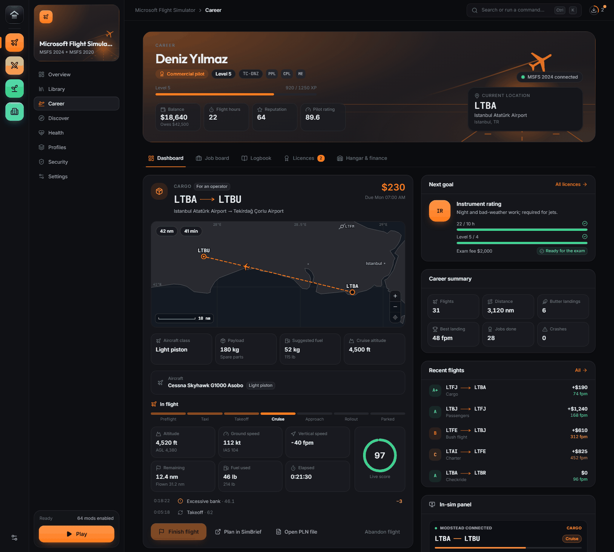
</p>

> **Status:** early development, like the rest of Modstead. The rules, the SimConnect protocol and the full job flow are
> covered by automated tests. Automatic flight loading, the toolbar panel and the main menu page have been tried in a
> real MSFS 2024 (1.9.21.0); the current toolbar panel (0.3.0) has not been flown with yet (see
> [Known limits](#known-limits-and-roadmap)). The app screenshots come from Modstead's preview mode with sample data; the
> main menu screenshots were taken in the sim with a sample career.

## Contents

- [Features](#features)
- [Screenshots](#screenshots)
- [It runs inside Modstead](#it-runs-inside-modstead)
- [How a career flight starts](#how-a-career-flight-starts)
- [In-sim toolbar panel](#in-sim-toolbar-panel-msfs-2020-and-2024)
- [Career page in the MSFS 2024 main menu](#career-page-in-the-msfs-2024-main-menu)
- [Rules and formulas](#rules-and-formulas)
- [Realism](#realism)
- [Research: how other career add-ons work](#research-how-other-msfs-career-add-ons-work)
- [Architecture](#architecture)
- [Data sources](#data-sources)
- [Testing](#testing)
- [Known limits and roadmap](#known-limits-and-roadmap)
- [FAQ](#faq)

## Features

- **Job board** at your current airport: cargo, passengers, charter, aircraft ferry, bush flights, air ambulance,
  scheduled airline flights and training flights. Listings depend on your licences, the aircraft classes you can fly
  and your reputation, and refresh every 4 hours. Each job shows distance, block time, payload, aircraft class, pay and
  XP on a world map.
- **Weather and time scenarios:** some jobs fly at night, at dawn or dusk, in rain, snow or a storm, with the sim's own
  weather presets and the time written into the flight; others use live weather and real time. Every listing shows its
  conditions, and the board can be filtered by time and weather. Night and bad weather pay more.
- **Two ways to earn:** fly *for an operator* (the aircraft, fuel and fees are theirs, you earn an hourly wage) or,
  after the CPL, fly *on your own account* (you pay rent, fuel and landing fees and keep the profit).
- **Automatic flight setup:** Modstead starts the sim if needed, picks a parking spot that suits the job and the
  aircraft from the sim's own airport data (or puts you on the runway with the engines running), writes the flight in
  the sim's own free-flight format with the route as the active GPS plan, moves the aircraft and loads the payload. It
  works from the sim's main menu and from inside another flight.
- **Flight tracking over SimConnect:** flight phases, landing rate, G and bank at touchdown, bounces, overspeed, stall
  and flap-speed warnings, low fuel and cheat detection (slew, teleport, refuelling in the air, crash).
- **Pre-flight checks:** tracking arms itself as soon as the required checks turn green, and the flight starts when you
  start the engines or move.
- **Licences and ratings:** SPL, PPL, CPL, multi-engine, instrument, helicopter, jet type rating, ATPL, narrowbody and
  widebody type ratings. Each needs hours, a level and a fee, then a checkride.
- **Logbook** with a score and grade for every flight, the flown track on a map, landing data, deductions, timeline and
  settlement.
- **Hangar and finance:** buy and sell aircraft, maintenance and wear, a loan with no time-based interest, and a
  transaction history.
- **SimBrief and PLN:** open the job in SimBrief with the route and aircraft filled in, or open the generated `.PLN`.
- **In-sim toolbar panel** for MSFS 2020 and 2024 that shows the route, phase, remaining distance, ETA, score and pay
  inside the sim, in full screen and VR.
- **Career page in the MSFS 2024 main menu:** a *Modstead Career* tile next to the sim's own tiles opens a full-screen
  page with the active job, the job board, aircraft choice with photos and your pilot profile. Take a job, pick an
  aircraft and start the flight without leaving the sim; mouse, keyboard and controller work as on the sim's own pages.
- **Aircraft photos** for 75 real aircraft families (Wikimedia Commons, credited in
  [`ui/career/aircraft/CREDITS.md`](ui/career/aircraft/CREDITS.md)).
- **Career journal:** a detailed log of the sim connection, every flight start step and the tracking, shown on the
  dashboard, so "what happened?" always has an answer.
- **Career paths:** airline, cargo, bush, air ambulance and rescue, charter and business jets, aerial work, or a
  freelance mix. The path shapes the job board, gives a three-step rank ladder (first officer → captain → senior captain…)
  and a small bonus on path jobs, and can be changed later. Start from scratch at the flight school or with the path's
  licences, hours and little money.
- **Three difficulties** (Easy, Normal, Realistic) and two starts per path: from scratch or experienced.
- **Free and local:** no subscription, no account and no server. Career data is plain JSON on your PC.

## Screenshots

| | |
|---|---|
| 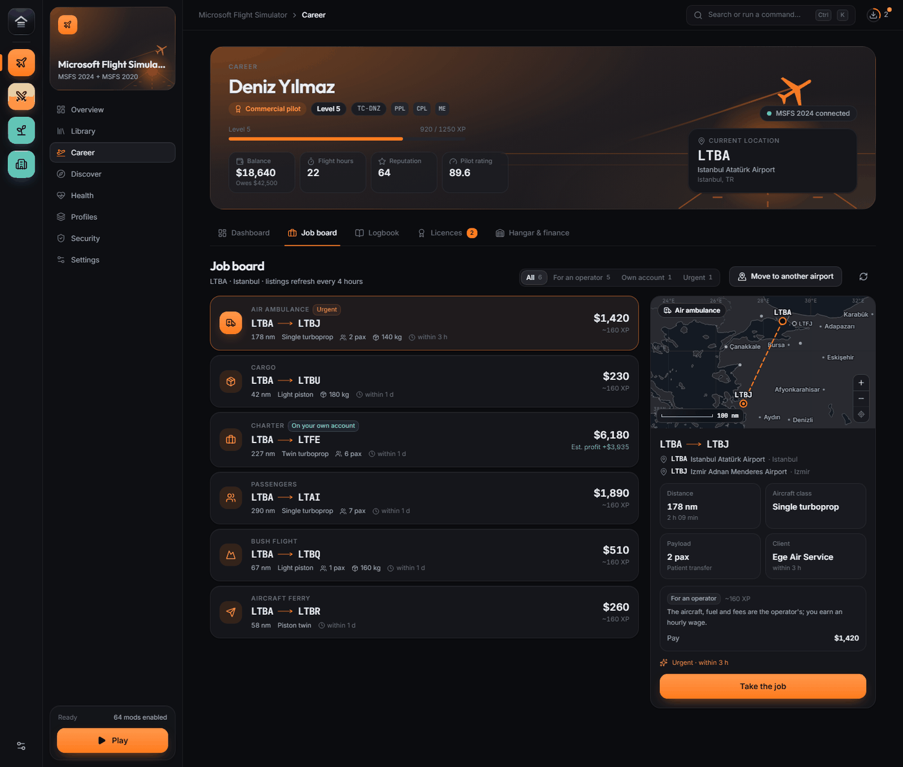 | 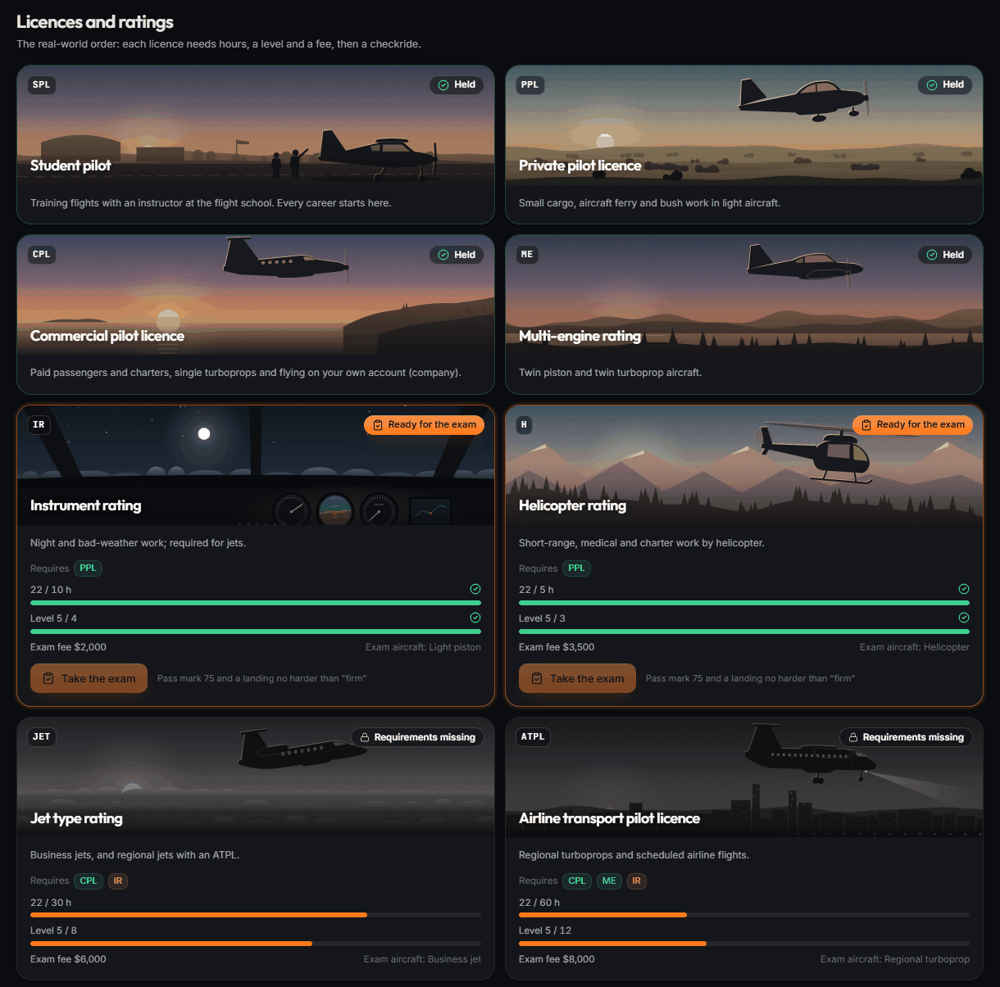 |
| **Job board** with a route map | **Licences and ratings** with checkrides |
| 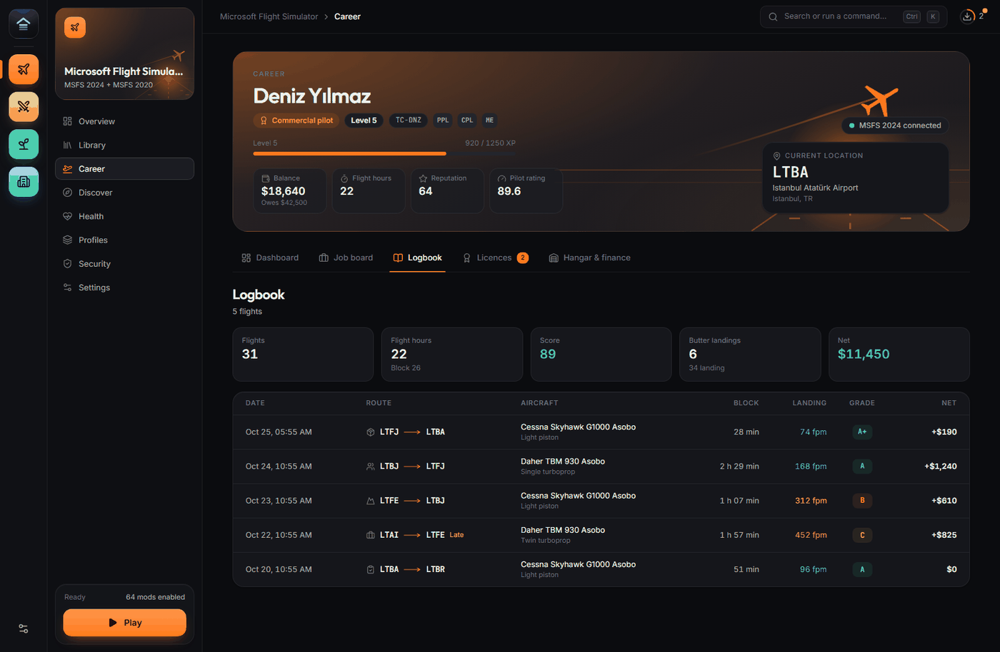 | 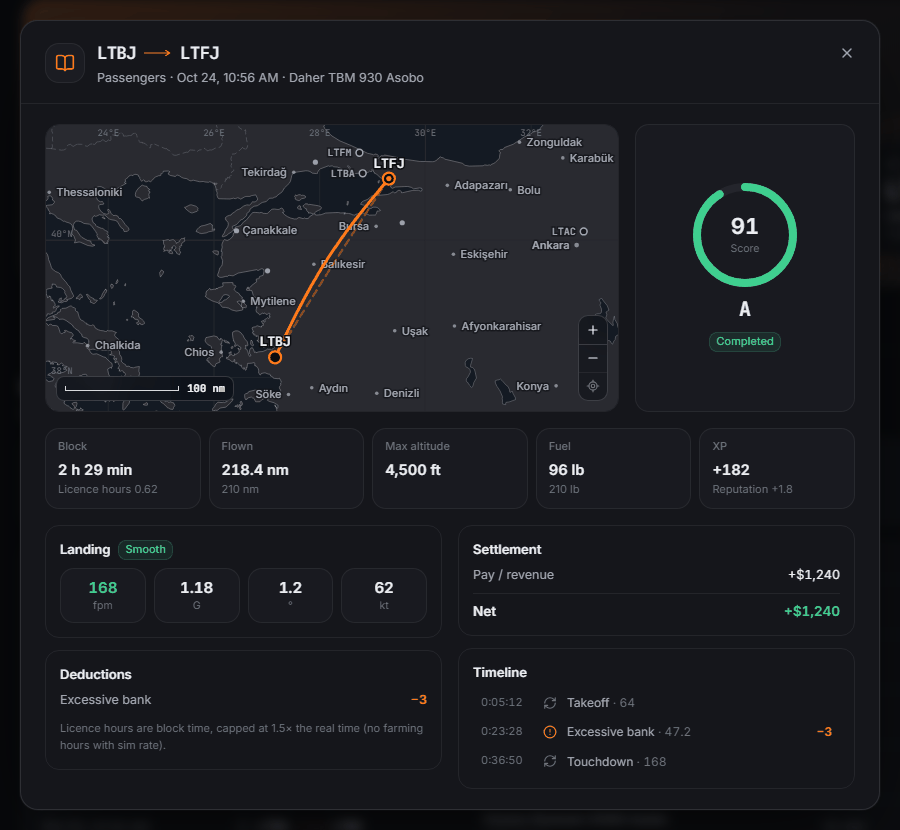 |
| **Logbook** | **Flight details** with the flown track |
| 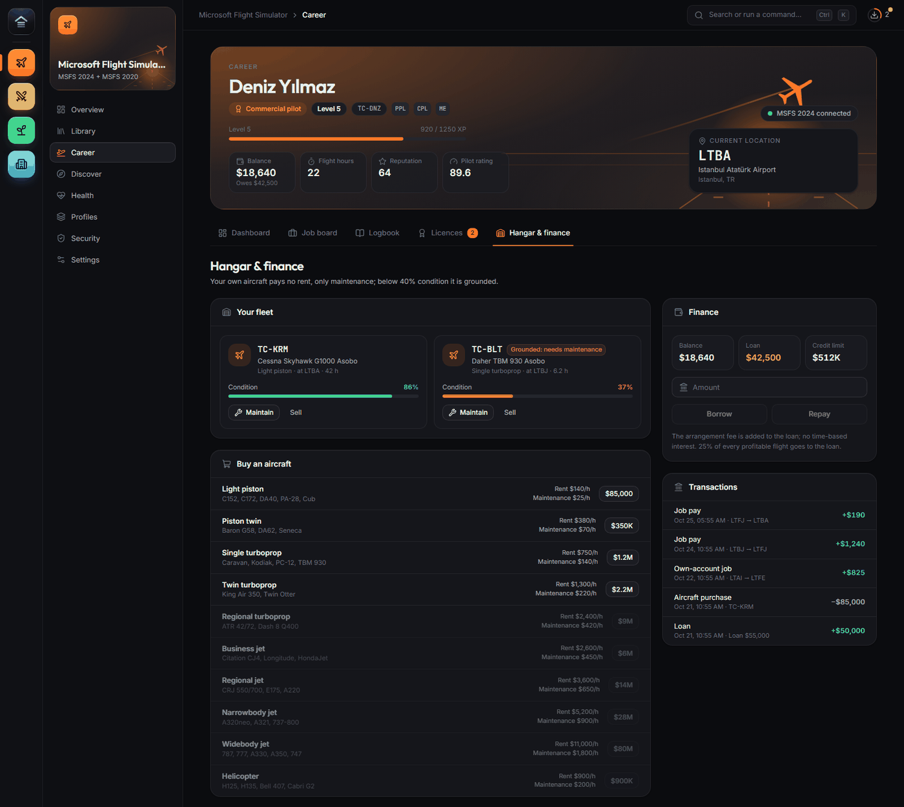 | 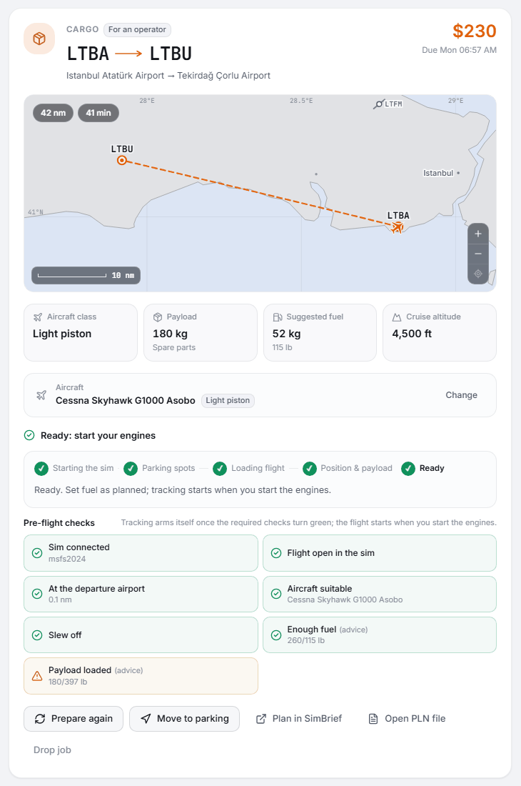 |
| **Hangar and finance** | **Pre-flight checks** (light theme) |
| 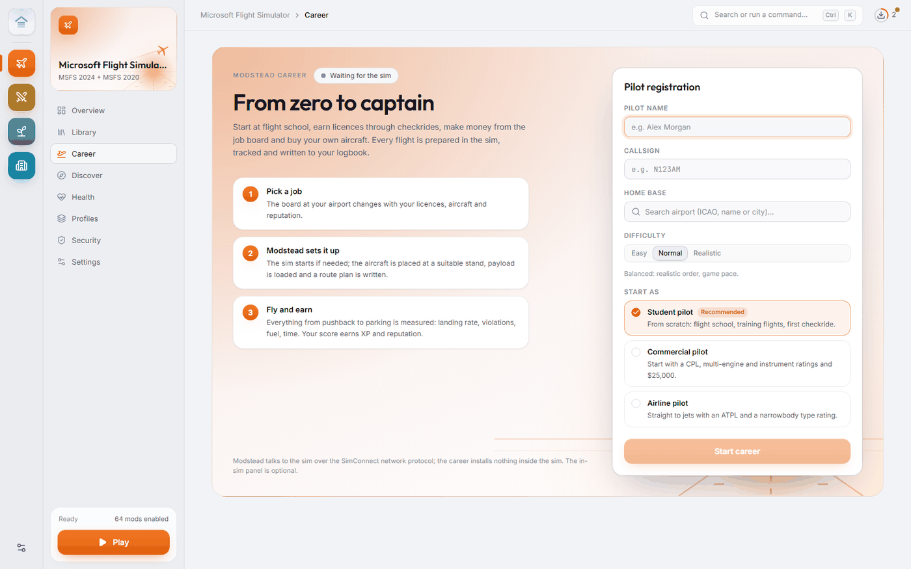 | 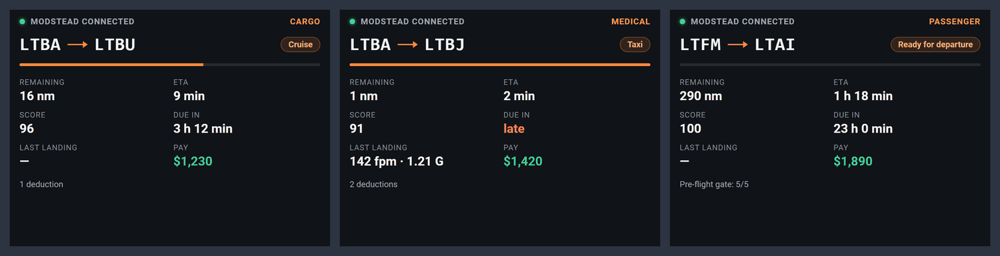 |
| **New pilot** (light theme) | **In-sim toolbar panel** (browser preview) |
| 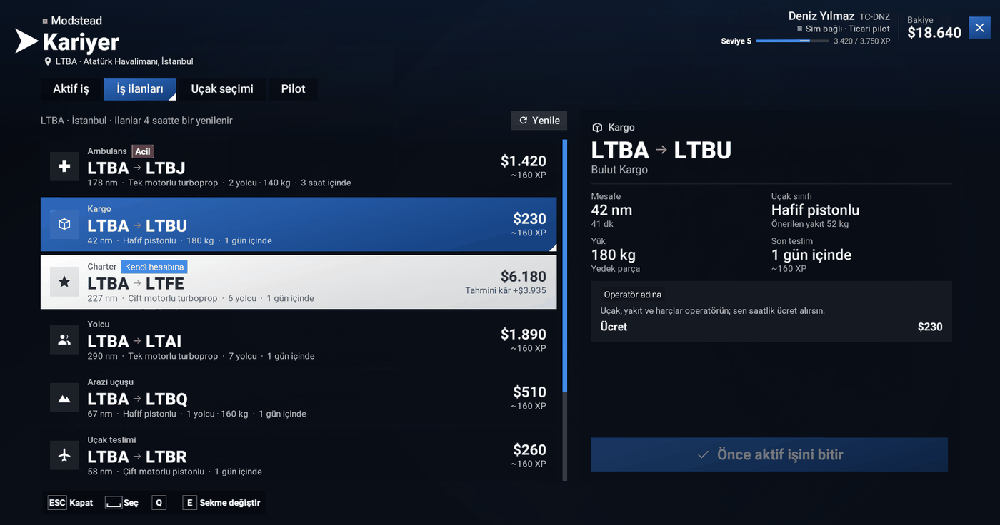 | 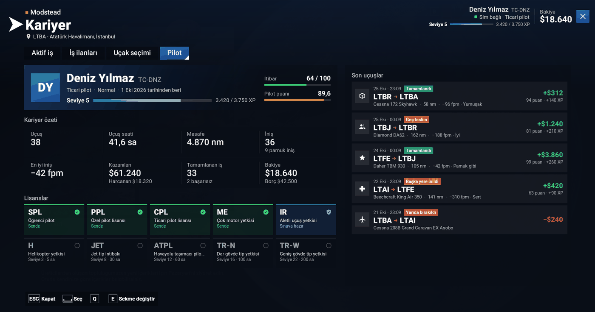 |
| **Job board in the MSFS 2024 main menu** (captured in the sim, Turkish interface) | **Pilot profile in the main menu** (captured in the sim) |

## It runs inside Modstead

The career mode is part of Modstead. Its data, its rules and the connection to the sim all live in the Modstead app;
the career itself needs nothing installed inside the sim. The toolbar panel and the main menu tile are optional
packages that only show what Modstead serves. **There is no career without Modstead:** while Modstead is closed, flights
are not tracked, the panel says "Modstead not connected" and the main menu tile does not appear.

## How a career flight starts

When you press **Start flight** (`engine.rs`):

1. If the sim is not running, Modstead starts it (Steam or Microsoft Store) and waits for the SimConnect connection.
2. The parking spots of the departure airport come **from the sim's own data** (`RequestFacilityData`: TAXI_PARKING
   type, name, number, radius and offset from the reference point). A spot that suits the job and the aircraft size is
   chosen: light aircraft go to the GA apron, airliners to a gate, cargo jets to the cargo apron. The result is cached
   for 30 days.
3. A `.FLT` (aircraft title, livery, parking spot or runway threshold, position, time, weather, plan) and a `.PLN`
   (direct route) are written. Time and weather come from the job's conditions: real time and live weather for a live
   job, the scenario's time and the sim's weather preset for a scenario job (see "Weather and time scenarios").
4. If you are already in a flight with the right aircraft and the job is live, the aircraft is moved straight to the
   parking spot or the runway (`Initial Position`); otherwise `SimConnect_FlightLoad` is sent. This works both from the sim's main menu and
   from inside another flight.
5. When the flight is open, the position is checked; if the aircraft is more than 150 m from the target it is moved
   there. The payload is written to the payload stations (station 1 counts as the pilot; the load is spread over the
   rest).
6. If the flight has not opened after 150 seconds, Modstead switches to **manual mode**: you open a free flight at the
   departure airport and press **Move to parking**. When the pre-flight checks turn green, tracking arms itself; the
   flight starts when the engines run or the aircraft moves.

Modstead's own repositioning is never counted as cheating (a 30-second window). While a flight loads and while the sim
loads a flight and places the aircraft (`FLT_LOAD`, `TELEPORT_*`, 5 seconds after `SimStart`), tracking does not
update, so momentary speeds seen during loading (8 kt) do not count as the start of the flight.

### What we learned in the real MSFS 2024 (October 2026, sim 1.9.21.0)

- **Flight file format.** With `FlightLoad`, 2024 only opens files shaped like its own free-flight file and silently
  ignores anything else (our 2020-style file did nothing in the main menu). `flt::write_flt_2024` is a template taken
  from the sim's `MISSIONS\Custom\CustomFlight\CustomFlight.FLT` with the aircraft-specific sections (fuel, engines,
  lights, cockpit variables) removed: the free-flight logic in `[ObjectFile]`/`[WolfProgram]`, cabin services, ATC and
  the window. `[Departure]`/`[Arrival]` are not written (2024 may then put the aircraft somewhere else). The plan goes
  in `[GPS_Engine]`: on a ground start it does not move the aircraft and enters the sim's GPS as the active plan (the
  next waypoint is the destination).
- **Aircraft you cannot fly.** Of the 520 titles that `EnumerateSimObjectsAndLiveries` returns, 351 are "Passive" models
  for AI traffic; they are filtered out and cannot be picked (`aircraft::is_passive`).
- **The menu sends data too.** In the main menu, 2024 keeps sending the user aircraft's data at the last flight's
  position (a placeholder 0°, 90° on first start). The camera tells whether you are in a flight (`CAMERA STATE`, once a
  second, on change): 32 main menu, 12 world map, 35 transition, 31 outside the user aircraft / "Ready to fly", 16
  in-game cinematic, 29 ESC menu, 2 cockpit, 3 external. Data that arrives with a menu camera is not counted as flying;
  when the sim is paused the data stops but the camera still shows a flight.
- **Runway start.** The sim's `FLIGHT_RUNWAY` state only opens cleanly when loaded from the main menu ("Ready to fly" →
  short take-off cinematic → cockpit, engines running). Loaded on top of an open flight, "Ready to fly" never comes and
  the sim stays in the cinematic (camera 16); the camera variable cannot be written either. So with a flight open, a
  runway start is loaded as `PREFLIGHT_TAXI`: pilot in the seat, engines running, no cinematic. If the camera then stays
  at 31, Modstead switches it to the cockpit (2). ("Reset view", `CAMERA REQUEST ACTION` 1, is not used because it moves
  the camera outside.)
- **Flight left in active pause (26.10.2026).** The sim holds a loaded flight in active pause at camera 31 until the intro
  cinematic ends; `RTC_END` releases both (parking: RTC_START → 2.6 s → RTC_END, fine). When no cinematic plays
  (`PREFLIGHT_TAXI` runway start, loading on top of an open flight) or it hangs, the release never comes: even after
  Modstead switches to the cockpit, the aircraft does not move with the engines running and the parking brake released
  (`IS IN ACTIVE PAUSE` = 1, `G FORCE` ≈ 0, `SIMULATION TIME` 0). The Pause key or ESC → Resume fixes it. `Pause_EX1` never
  reports active pause; SimConnect does not know the name `ACTIVE_PAUSE_TOGGLE` (exception 7). None of the sim's own FLTs
  (`MainMenu.FLT`, templates, `CustomFlight.FLT`, the flight state library) has a key that prevents it. `pause_guard`
  catches it in the two minutes after a launch with `IS IN ACTIVE PAUSE` (or, if that cannot be read, sim time and G) and
  tries, in order, SimConnect `PAUSE_OFF`, the in-sim code (the sim's own toolbar call `TOOLBAR_SET_ACTIVE_PAUSE`, false,
  in the main UI view; `/api/sim-assist`) and `PAUSE_ON` → `PAUSE_OFF`; otherwise it tells the user to press Pause. Once
  the sim is seen running the guard turns off, so a pilot's own later active pause is never touched. All of it appears in
  the journal as `[duraklatma]` lines.
- **Parking.** When starting at a parking spot, 2024 deliberately starts you next to the aircraft (external control);
  Shift+C boards it. Switching the camera to the cockpit does not seat the pilot, it only moves to the eyes of the pilot
  standing outside, so Modstead leaves it alone.
- **Engines cannot be started from outside.** The `ENGINE_AUTO_START` event and the `GENERAL ENG COMBUSTION` variable have
  no effect on 2024 aircraft; engines only come running with the sim's taxi or runway state.
- **Avionics.** `FlightPlanLoad` only fills the sim's ATC plan; sending a plan to the avionics needs the "Planned Route
  API" that is open to JavaScript inside the sim (Working Title, DevSupport, 2025). `[GPS_Engine]` loads it into the
  sim's GPS.

All of this can be followed in the career journal (below).

### Career journal

`career::journal`: a detailed, continuous log of the sim connection and the tracking
(`<cache>/career/logs/career.log`, rotated at 4 MB, two old copies kept). It records the connection, every start step,
the path and target of FlightLoad, the sim's flow and system events, camera changes, menu/flight transitions,
teleports, SimConnect exceptions, tracking phases and penalties, your commands, package installs and actions that come
from inside the sim. The *Journal* card on Career → Dashboard shows the latest lines.

## In-sim toolbar panel (MSFS 2020 and 2024)

A Modstead panel in the MSFS toolbar: route, phase, progress, remaining distance, ETA, score, deadline, last landing and
pay, and the pre-flight gate while preparing. Unlike a window on top of the desktop, it also works in full screen and VR.

<p align="center">
  
</p>

The image above is a **browser preview** of the panel's own HTML, CSS and JavaScript with simulated `L:` variables,
inside the sim's own panel frame (its `common.css`, `ingameUi` template CSS and Roboto fonts); it is not a capture from
the sim.

**Screens** (a status dot in the title bar: green connected, grey connecting, red not connected):

| State | What it shows |
|---|---|
| Connecting | Until `SEQ` increases once after the panel opens (at most 2.5 s). |
| Modstead not connected | Why, and what to do. If the language was never learned, the English text is shown below too. |
| No career / no active job | What to do and where in Modstead (Modstead › MSFS › Career, Career › Job board). |
| Preparing / ready for departure | Route, distance, planned block time, pay, deadline and the pre-flight gate by name. When ready, only the remaining suggestions and when tracking starts. |
| In flight | The route line fills with progress; remaining nm and ETA in large type; score and grade, number of deductions, fpm and G of the last landing, pay, time to deadline (yellow when late); a phase timeline (taxi → parked) and the next phase. |
| Interrupted | Remaining and total distance, score, pay and deadline; a note that the flight resumes from the same place. |

When the panel is resized the whole layout scales with it (the font size is computed from the panel's inner size and
everything is in em). A wide, low panel switches to two columns; in a narrow panel the checklist becomes one column.

**Why a toolbar panel** (research summary):

- `SimConnect_Text` cannot be used in 2020 and does not exist in the 2024 reference.
- An EFB app only shows on the tablet and needs the SDK's `efb_api` package.
- A panel talking to a local HTTP server would open a new listening socket.
- A toolbar panel that reads `L:` variables needs no new port, no dependency and no injection, and the same package
  works in MSFS 2020 (SU12 and later) and MSFS 2024.

**Data path:**

- Over its open SimConnect connection, Modstead writes the `L:MODSTEAD_HUD_*` variables once a second
  (`AddToDataDefinition` + `SetDataOnSimObject`).
- The fields are listed in `hud.rs` → `FIELDS`. ICAO codes are sent as base-37 numbers. The pre-flight gate is a single
  number in `CHECK_LIST`: one base-4 digit per check in `CHECK_IDS` order (0 absent, 1 done, 2 missing, 3 missing
  suggestion).
- The panel (`ModsteadCareer.js`) only reads and displays. If `SEQ` stops increasing for 4 seconds it says "Modstead not
  connected". The first `SEQ` seen when the panel opens is only a baseline: an `L:` variable keeps its last value after
  Modstead closes.
- The language comes from `LANG`; the panel keeps the last known language in the sim's data store
  (`MODSTEAD_HUD_LANG`).
- If the sim rejects the `L:` definitions (older 2020 builds), writing stops for that session.

**Package** (`games/msfs/hud/package`):

- Embedded in the app. Install, update and remove it from Career → Dashboard → **In-sim panel**.
- Installing writes it to the mod library, generates `layout.json` and `manifest.json` on the spot and links the package
  into the sims' Community folders, the same way as any other mod. The sims must be closed.
- The panel definition is `InGamePanels/modstead-career-hud.spb` (source: `hud/source/modstead-career-hud.xml`).
- This `.spb` was generated once from the documented SPB format
  ([spb2xml24](https://github.com/vectorial287/spb2xml24) `docs/FORMAT.md`). It was checked two ways: the same encoder
  reproduced the `.spb` of an installed panel byte for byte, and our file decodes back with every field intact.
- If the definition changes, the `.spb` must be rebuilt in MSFS developer mode, with the SDK package tool or with the
  same encoder, and `HUD_VERSION` raised. In 0.2.0 the default size grew from 24×30 to 35×37 (at least 26×26); the
  unit is a percentage of the screen height (the sim's own Objectives panel is 36×22, METAR 45×15, ATC 48×55). The
  sim remembers the size you set; the new default shows on first open or after resetting the layout.

**The sim's panel frame** (MSFS 2024, `fs-base-ui/html_ui/Templates/ingameUi`): `ingame-ui` > a header
(`ingame-ui-header`: title, minimise, maximise, pin, close) + `.ingameUiContent` > `.ingameUiWrapper` > the panel's
own elements. The background of `ingame-ui` is `--backgroundColorContrastedPanel` (translucent light grey), the
header's is `--backgroundColorPanel`; the header text comes from `Name` in the `.spb` and is upper-cased. The panel
definition also supports `headerVisible` and `noBackground` (hiding the header also removes the close button; not
used).

**First real test (2024, 0.1.0) and fixes (0.2.0):**

- *Texts were empty:* the installed `ModsteadCareer.js` had a real line break inside a string (instead of `"\n"`). That
  syntax error stopped the whole script: the custom element was never defined and no `SimVar` was read. The dot, arrow
  and empty pill that did show were CSS only (the dot was green in CSS and did not reflect the connection). A test in
  `hud.rs` now checks strings and brackets. Field and method names also carry an `ms` prefix, so they cannot clash with
  built-in properties such as `HTMLElement.lang` (`this.lang = null` sets the attribute to "null") or with the sim's
  `UIElement` base class.
- *The dark background stopped halfway:* with `content-fit="false"` the two wrapper layers got no height and the root
  only grew as tall as its content, showing the grey background of `ingame-ui` below. Now `content-fit="true"` (the
  sim's `fittedContent` class) and the wrappers stretch; the background is on `ingame-ui` itself, with no margin.
- *A grey title bar reading "MODSTEAD CAREER":* the sim's buttons stay; the strip uses the same dark surface, and a
  status dot + MODSTEAD + Career/Kariyer replace the title text. Turkish texts are written in upper case: the sim's
  engine turns "i" into "I" with `text-transform`, not into "İ".
- The font is the sim's own Roboto (`font-family: "Roboto-Regular"`, weights 300/400/600/700); the "Roboto Mono" of the
  old CSS does not exist in the sim.

0.2.0 was tried in every state and four sizes on a test page built with the sim's own `common.css`, `ingameUi` template
CSS and Roboto fonts. A DOM and computed-style check inside the real sim (Coherent GT) has not been done yet; the
debugger is at `http://127.0.0.1:19999`, and the page is listed in `pagelist.json` as `ModsteadCareer.html` (its id
changes on every start).

**Updating without restarting the sim (0.3.0):** the sim reads panels and the package list only at start-up, and
Modstead never writes to the mod folder while the sim runs. So the panel itself is now a small loader
(`ModsteadLoader.js`): while Modstead is open it takes the code (`/hud/app.js`), the styles (`/hud/app.css`) and the
markup (`/hud/body.html`) from Modstead's local server; while Modstead is closed it uses the copy in the package. It
polls the version (`/hud/v`) every 5 seconds and reloads itself when it changes. Package updates still happen with the
sim closed; the card offers "Update when the sim closes".

### Local server

`career::hud_server` (added with the maintainer's approval): it listens on `127.0.0.1`, on the first free port of
`47213`–`47215`. When tablet access is on, it also listens on the local network address at the same port (rules under
"Flight deck"). The endpoints and rules are in [`hud/menu/API.md`](hud/menu/API.md) (Turkish). In short:

- It gives the sim's pages their code, styles and career data: status, live data, job board, aircraft and their photos.
- It takes career actions from inside the sim: accepting a job, choosing an aircraft, starting and cancelling.
- `Host` must be `127.0.0.1` or `localhost`, as protection against DNS rebinding.
- CORS and `POST` are open only to the sim's `coui://` pages.
- There is no file or shell access; it never reads files from disk.

Aircraft photos are embedded at build time (`build.rs`); the family matching lives in
`ui/career/aircraft/families.json`, shared with the app's interface.

### Panel 0.4.0

- Live map (north up, works offline). The aircraft icon is drawn from SimVars about 30 times a second. It shows the
  planned route, the flown track, departure and destination (with runways when close), nearby airports, a range ring and
  a wind arrow. There are zoom buttons and an "AUTO" mode that keeps the aircraft and the destination in view.
- Flight data strip (ground speed, altitude, vertical speed, heading) and head/crosswind against your track.
- Fuel on board, in the plan and estimated at the destination. The estimate turns amber below final reserve and red
  below zero.
- Destination weather: category, wind, the wind components for the best runway end, and runway length available
  against required.
- Your latest deductions.
- "OPEN IN WINDOW" opens the flight deck in a separate Modstead window. "OPEN ON TABLET" shows the link and a QR code.
- The layout follows the panel size. A small panel shows Summary / Map / Details tabs; a large one shows the map and
  the details side by side.
- The sim's own pop-out button works too.
- Detailed data comes from the local server (`/api/call/…`). Without it, the panel keeps working on the `L:` variables.
- The map is in Web Mercator with the local server's tiles underneath (`/api/tiles/relief|sat/…`): offline shaded relief by default, satellite with the "MAP / SAT" button. The course is magenta, the flown track orange, airports use chart symbols. Without the tile server the map keeps its vector look.

## Flight deck (separate window, browser, tablet)

A full-page flight companion for a second screen. Open it from Career → "Flight deck" or from the in-sim panel. The
same page runs in a separate Modstead window, in a browser on the PC, and on a tablet or phone on the same Wi-Fi. It
only reads; it never changes anything in the sim.

| Section | Content |
|---|---|
| Map | Follows the aircraft; north-up or track-up. Shows the route, flown track, alternate, nearby airports and range rings. Touch drag and pinch zoom. Works offline (Natural Earth). |
| Flight data | Ground speed, IAS, altitude, height above ground, vertical speed, heading, wind and its components, OAT, QNH. |
| Progress | Phase timeline, distance flown and remaining, ETA (UTC and local), time left to the deadline, top of descent (3°). |
| Fuel | On board, used, burn per hour, endurance, estimated at destination, reserve status, compared with the dispatch release. |
| Destination | Decoded METAR, runway wind components, runway length available and required, density altitude, alternate. |
| Score and job | Live score, deductions, landing report; job type, client, load, pay, deadline, aerial-work objectives. |

- **Separate window:** "Open in window" opens Modstead's `msfs-deck` window. The page comes from the local server
  (`http://127.0.0.1:<port>/deck`). The window is in no capability file, so it cannot call app commands; it reads its
  data over HTTP.
- **Tablet:** turn on "Tablet or phone" and Modstead also listens on the PC's local network address. Only private
  ranges are used: 10/8, 172.16/12 and 192.168/16. The card shows the link and a QR code.
- **Access key:** the link carries a 128-bit key, stored only in Windows Credential Manager (`Modstead/MSFS/DeckKey`).
  "Renew link" makes a new key, and old links stop working.
- **Default:** tablet access is off. The on/off choice is kept in `career/deck.json`.
- **Rules on the local network:**
  - `Host` must be exactly `<network address>:<port>`.
  - Every `/api/*` request needs the key.
  - Only `GET` requests and read-only commands are allowed: state, live data, map airports, weather, flown track and
    deck info.
  - `/hud` and `/menu` are not served.
  - At most 32 connections.
- **Protecting the key:** the page removes the key from the address bar on load, and responses carry
  `Referrer-Policy: no-referrer`. In release builds the page comes with its own CSP (same origin only).
- **Firewall:** Windows Firewall asks the first time; choose "Private networks". If you deny it, Modstead cannot tell:
  the tablet simply won't connect.
- **Keeping the screen on:** Wake Lock only works over HTTPS or on the same PC; on a tablet the page says so.
- **Code:** the page is `deck.html` (Vite's second entry; code in `ui/deck/`). In development the local server passes
  these paths through to Vite.

## Career page in the MSFS 2024 main menu

<p align="center">
  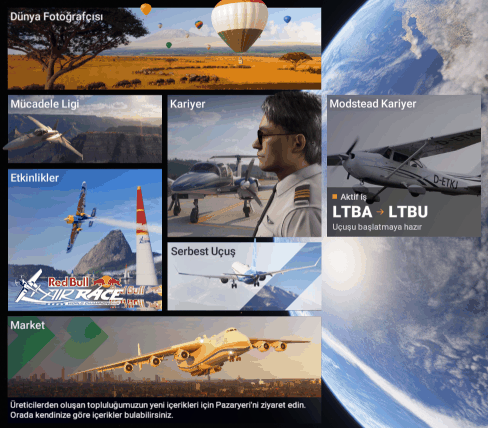
</p>

A *Modstead Career* tile in the MSFS 2024 main menu and a full-screen career page (`career::menu`, `hud/menu-package`,
interface in `hud/menu`). Tried in the real sim (1.9.21.0, fs-base-ui 0.1.10) in October 2026. The screenshots on this
page were taken in the sim with a sample career and the Turkish interface.

**How it gets in.** MSFS 2024 does not let Community packages replace the sim's own HTML files (`mainUI.html`
included). The root component of the main menu can be replaced, though: the MasterPage under `fs-base-ui/cookedcomps`
(`{7DA60FBA-EF32-48F2-974D-F8BEA35337A4}`, a one-line `.html` and a `.json`). On install, Modstead reads **the copy in
your own sim**, adds an invisible image before the last `</ui-resource-element>` and writes the result into the
package. The image's `onload` runs the loader (`/Modstead/ModsteadMenuLoader.js`) only in the main menu and only once.

- The code of the tile and the page comes from the local server (`/menu/app.js`, `/menu/app.css`). The loader asks for
  the version every 5 seconds; when Modstead updates, it removes the old code and loads the new one without a sim
  restart.
- With Modstead closed, nothing is added to the menu. The package is only linked into MSFS 2024.
- If another package already replaces the same component, nothing is installed and the card says why.

**Protection** (approved by the maintainer): a sim update that changes the component could break the menu with an old
copy.

- The package records the sim version, the fs-base-ui version and a digest of the component (`modstead-menu.json`). On
  the Microsoft Store the sim version is read from the package key in the registry (`stores::appx_versions`); on Steam
  from `buildid` in the `appmanifest`.
- While Modstead is open it checks every 30 seconds, whenever the sim is closed. If the component changed, the package
  is regenerated; if that is not possible, the package is removed and you are told.
- Known gap: if the sim updates while Modstead is closed and is then started without Modstead, the protection cannot
  run for that start.

**Mouse.** In the sim's menu, mouse events (mousedown, click) only reach elements that carry `data-input-group`; other
elements only get hover, and the click goes to the sim itself. The tile carries `generic-button`, the page
`inputLocker`.

**Keyboard and controller.** While the page is open, the sim's main menu also handles keys: ESC opens "Quit to
desktop?", Space and Q/E reach the tiles and tabs behind the page. So the page behaves like the sim's own pages:

- The sim's main menu module (`coui://html_UI/Global/lib.js`; `import()` returns the same live instance) exports the
  input stack (`UIInputStackListener`), `setInputBar`/`clearInputBar` and `InputBarParams`/`InputBarButtonParams`. The
  minified export names can change with every update, so they are found by class and function name.
- When the page opens, `KEY_MENU_SR_*` actions (back, select, directions, next/previous tab) are added to the input
  stack and our own buttons go into the sim's input bar: "ESC Close/Back · Select · Q E Switch tab". When it closes,
  both are removed and the sim's own bar ("ESC Quit to desktop · R Release notes") comes back.
- The context is `MAX` (the sim's transitions and `lockInput` use it too). In `DEFAULT`, the main menu re-registered
  its own actions when focus changed and took the keys back (Space opened the Marketplace tile behind the page). When a
  sim popup (the quit question, a notification) appears, the context is released and taken back once it closes.
- On the keyboard "select" is Space (⎵ in the sim's input bar); Enter never reaches the page in the menu.
- If the module cannot be found (an older sim), the page falls back to its own key bar and keyboard events.

**The page.** Tabs: Active job (photo; a departure–arrival strip with runway, length and elevation; payload, fuel,
altitude, customer, deadline and XP; on the right the aircraft, the start position and the preparation checks), Job
board, Aircraft choice and Pilot (level and XP, reputation, pilot rating, career summary, licences, recent flights).
The background is fully opaque; when it was translucent the sim's tiles showed through. The sim's font has no "→" (it
renders as a box): texts use "–" and the route arrow is an SVG.

<table>
  <tr>
    <td width="50%"><br><sub><b>Job board</b> inside the sim</sub></td>
    <td width="50%"><br><sub><b>Pilot</b> tab inside the sim</sub></td>
  </tr>
</table>

**Testing.** Outside the sim: headless Edge and a page that imitates the sim's main menu with sample data. In the sim:
the Coherent debugger (`127.0.0.1:19999`, read-only inspection and live reload); real clicks and keys only with the sim
in front.

Rich text through CommBus (`SimConnect_CallCommBusEvent`) in 2024 is the next step for the toolbar panel.

## Rules and formulas

### Licences

Normal difficulty. Easy: ×0.5 hours, ×0.6 fees. Realistic: ×2 hours, ×1.4 fees.

| Licence | Requires | Hours | Level | Fee | Checkride aircraft | Unlocks |
|---|---|---|---|---|---|---|
| SPL Student pilot | — | — | 1 | — | — | training flights |
| PPL Private pilot licence | SPL | 3 | 2 | $800 | light piston | cargo, aircraft ferry, bush |
| CPL Commercial pilot licence | PPL | 15 | 5 | $2,500 | light piston | passengers, charter, air ambulance, single turboprops, own-account jobs, aircraft ownership, loans |
| ME Multi-engine rating | PPL | 8 | 3 | $1,500 | piston twin | twins |
| IR Instrument rating | PPL | 10 | 4 | $2,000 | light piston | required for jets |
| H Helicopter rating | PPL | 5 | 3 | $3,500 | helicopter | helicopters |
| JET Jet type rating | CPL, IR | 30 | 8 | $6,000 | business jet | business jets |
| ATPL Airline transport pilot licence | CPL, ME, IR | 60 | 12 | $8,000 | regional turboprop | scheduled airline flights |
| TR-N Narrowbody type rating | ATPL, JET | 100 | 16 | $15,000 | narrowbody | A320, 737 |
| TR-W Widebody type rating | TR-N | 200 | 22 | $30,000 | widebody | 787, 777, A350 |

To pass a checkride: arrive, score at least 75 (Easy 65, Realistic 85) and land no harder than "firm". The fee is paid
even if you fail.

### Pay

- **For an operator:** `pay = hourly wage × (0.5 + block hours) × (1 + short-flight bonus) × job type × reputation / √difficulty`
- **Own account:** `revenue = typical cost × 1.1 + operator pay × 2 × (0.4 + 0.6 × load factor) × job type × reputation / √difficulty`;
  typical cost = rent + fuel + landing fee. The real cost is measured during the flight: rent (block time × hourly
  rent) or maintenance on your own aircraft, fuel burned × price, the destination's landing fee and damage.
- Short-flight bonus: below 150 nm, `0.6 × (1 − nm/150)`. Job type: air ambulance ×1.4, urgent ×1.35, bush ×1.3,
  charter ×1.25, ferry ×0.8. Reputation: 0 → ×0.85, 50 → ×1, 100 → ×1.2.
- Landing fee: $7 × max weight / 1,000 lb × (large 1.5 · medium 1 · small 0.3). Fuel: avgas $2.50/kg, jet fuel $0.95/kg.
- Late delivery: 10% per hour, at most 50%.

### Score (starts at 100; each rule has a cap)

| Rule | Deduction | Cap |
|---|---|---|
| Overspeed | 5 | 15 |
| Stall warning (above 150 ft AGL) | 5 | 15 |
| Flap speed limit | 3 | 9 |
| Bank > 45° (jets 35°) | 3 | 9 |
| Pitch > 25° / < −15° | 3 | 9 |
| G > 2.5 or < −1 | 5 | 10 |
| > 265 kt below 10,000 ft (turbine) | 5 | 10 |
| Bank > 30° close to the ground (below 1,000 ft) | 3 | 6 |
| Taxi > 30 kt off the runway for more than 3 s | 2 | 6 |
| Bounce | 4 | 12 |
| Landing below final reserve (piston 45, turbine 30, helicopter 20 min) | 5 | 5 |
| Landing from an unstable approach (below) | 5 | 5 |
| Tail strike (jet airliners: regional 10.5°, narrowbody 11°, widebody 10°) | 10 | 10 |
| Touchdown before the threshold | 8 | 8 |
| Long landing (beyond the touchdown zone + 150 m) | 3 | 3 |
| Off the centreline (half the runway width − 4 m) | 2 | 2 |
| Maximum takeoff / landing weight exceeded | 5 + 5 | 5 + 5 |
| Cloud or low visibility for more than 30 s without a current instrument rating | 10 | 10 |
| Unpressurised cabin above 12,500 ft for more than 30 min, or above 15,000 ft (FAA 91.211) | 5 | 10 |
| Landing rate (scaled by class; light aircraft: < 200 fpm 0 · 200–300: 3 · 300–400: 8 · 400–500: 15 · ≥ 500: 25) | | |
| Landing G > 1.5: 5 · > 2.0: 10; bank > 6°: 5 · > 10°: 10 | | |

Grades: A+ ≥ 95, A ≥ 88, B ≥ 78, C ≥ 65, D ≥ 50, F. **A flight is void** after slew in the air, a teleport or phase
skip, refuelling in the air, a flight that starts in the air, or a crash (score 0, no pay, −15 reputation for a crash).

The score sets XP and reputation, not money: a wrong deduction never costs you cash. Money only follows real events:
late delivery, damage, fuel and rent.

### XP, levels and reputation

- `XP = (100 + 60 × block hours) × score/100 × distance factor × class factor` (+400 for a passed checkride).
  Distance: < 50 nm 0.7 · < 150 0.85 · < 600 1 · < 2,500 1.1 · longer 1.2. Class: light aircraft 1 … widebody 1.5.
- Total XP for level L: `250 × L × (L − 1) / 2`.
- Reputation (0–100, starts at 50): `(score − 70) / 10`, clamped to −5..+3; late −3, failed −6, crash −15.
- Pilot rating: halfway between the average of the last 10 flights and the average of all flights.
- Licence hours are block time, capped at 1.5× the real time, so sim rate cannot farm hours.

### Aircraft, damage and loans

- What you can rent depends on the airport size (small airports: light and twin pistons, single turboprops and
  helicopters only).
- Your own aircraft: no rent, but maintenance; 12% wear per 100 hours; a hard landing costs 2 condition points,
  structural damage 8; below 40 it is grounded. Selling returns 70% of the price × condition.
- Damage class: landing above the class's "firm" threshold × 1.5 or G > 2 → inspection; × 2 or G > 2.6 → structural.
  Rental excess: inspection 0.5 hours of rent, structural 3, crash 20.
- Loan (with a CPL): limit `20,000 × level² × (0.5 + reputation/100) + half the fleet value`; an arrangement fee of 10%
  (Easy 5, Realistic 15) is added to the loan; no time-based interest; 25% of every profitable flight goes to the loan.

### Add-on aircraft

Community and third-party aircraft (Fenix, PMDG, iniBuilds, FlyByWire, Just Flight, Black Square, freeware mods) work
in the career like the sim's own aircraft (`career/addons.rs`). The sim's list (`EnumerateSimObjectsAndLiveries`) only
arrives in 2024 with the sim running, and an aircraft's values are only known once you board it. So Modstead reads the
files of the packages in its library and in the sims' Community folders, **read-only**:

| Format | What is read |
|---|---|
| 2020 (including the legacy format in 2024) | `SimObjects/Airplanes\|Rotorcraft/<folder>/aircraft.cfg`: each `[FLTSIM.n]` is a separate title in the sim (AI variants with `isUserSelectable = 0` are skipped), `[GENERAL]` ICAO fields; `flight_model.cfg` and `engines.cfg` next to it (very old aircraft keep everything in `aircraft.cfg`). Livery packages take their base's values through `[VARIATION] base_container`. Thumbnail `texture.<livery>/thumbnail.jpg`. |
| 2024 modular | The title is in `presets/<developer>/<preset>/config/aircraft.cfg`. Values are merged in the order preset > attachments (`attached_objects.cfg` → `attachment_root`, inheritance via `attachment.cfg` → `[Inherit] base`) > `common/config`. Liveries are `liveries/<developer>/<livery>/livery.cfg` (`[GENERAL] name`); `[SELECTION] required_tags` must match the `[Tags]` of the preset's attachments ("Disabled" matches no preset). Liveries that other packages add to the same aircraft folder count too. Thumbnail: the livery's `thumbnail/thumbnail.png`. |

- **Parser:** section and key names are case-insensitive; `;`, `//` and `#` comments and end-of-line comments outside
  quotes are dropped; quotes are stripped; a section written twice is merged and the last value of a key wins. UTF-8,
  UTF-16 and Latin-1 are read; cfg files over 4 MB are skipped.
- **Safety:** nothing is executed and nothing is written. Links inside a package (junctions, symlinks) are not
  followed; attachment paths are locked to the package folder with `fsx::resolve_under` and re-checked by canonical
  path. A thumbnail is only a jpg/png from the index inside its own package (8 MB at most); the UI gets raw bytes and
  turns them into a `blob:` URL (the CSP is unchanged).
- **Which aircraft:** only packages enabled in at least one sim (linked, physically in Community, or another tool's
  link). The list merges the sim's list, flown aircraft and mod packages; the same title (case-insensitive) is one
  entry, the sim's spelling is kept and liveries are merged. Titles from a package show a "Mod" badge, the package name
  and the sims it is enabled in (2020/2024). If the connected sim does not have the package, the card says so
  ("Not enabled in 2024").
- **Class** (`addons::class_for`): manual > ICAO type code > the sim's values (you boarded it) > the package files
  (engine type and count, max weight; the helicopter folder) > the name. The type code comes before weight: by weight the
  737-700 and A318 look like regional jets and the Global 7500 like a regional jet too. Confidence: type code,
  helicopter folder and sim values are "certain", package values "likely", the name "a guess". A manual class
  (`msfs_career_set_class`) is kept; the UI says "automatic · from the ICAO type code" or "manual".
- **Type ratings:** there is no separate table; the type code gives the class and the class's licences give the rating
  (`aircraft::ICAO_TYPES`): A318–A321, A19N/A20N/A21N, B731–B739, B37M/B38M/B39M/B3XM, B752/B753, MD-80 → narrowbody
  (TR-N); B788/B789/B78X, A332–A339, A359/A35K, A388, B744/B748, B772–B77W, MD11 → widebody (TR-W); CRJ, ERJ/E-Jet,
  A220, BAe 146 → regional jet; ATR, Dash 8, Saab 340 → regional turboprop; business jets, turboprops, pistons and
  helicopters as well.
- **Dispatch release:** before the aircraft is loaded in the sim, the package's values (MTOW, MLW when
  `max_landing_weight` exists, empty weight, fuel capacity from legacy `[FUEL]` tanks or `[FUEL_SYSTEM]` `Capacity:`,
  cruise speed, engines); once you board it, the sim's values win.
- **Own EFB:** developers whose aircraft manage payload and fuel in their own tablet (Fenix, PMDG, iniBuilds,
  FlyByWire, Headwind, Leonardo, FSLabs, Aerosoft CRJ, Just Flight, Black Square, TFDi, FlightSim Studio, Hot Start,
  Salty, HorizonSim, A2A) are recognised from the title, package folder, package name or creator. Modstead does not
  write the payload to such an aircraft; the active job shows an "Enter in the EFB" note with passengers, cargo and block
  fuel. It can be set per aircraft in the Hangar list (`msfs_career_set_loading`, `games/msfs/career/aircraft-prefs.json`;
  kept when the career is reset). The link thread reads the same answer through `aircraft::manages_own_loading`.
- **Images:** first the package's own thumbnail (of the chosen livery), then the family's bundled photo, then the class
  illustration. The real type name comes from the ICAO code ("A320" → Airbus A320), otherwise from the family; the buy
  dialog and the cards show it.
- **When it is read:** a few seconds after the app starts, in the background; then whenever the aircraft list is asked
  for and the library scan has changed. Each package's result is cached until its `manifest.json`, `layout.json` or
  `SimObjects` changes. "Refresh list" rescans the disk (for packages added to Community by hand).
- **UI:** the Choose aircraft dialog has All / Sim / Mod, class and search (title, type, ICAO, package, creator); a mod
  package's variants share one card. In Hangar → "Aircraft in the sim", each aircraft's class and loading method are
  automatic or set by hand.
- **Testing:** `cargo test -p game-msfs career::addons` (cfg parsing, 2020 and 2024 modular samples, livery packages,
  helicopters, not following links, merging); `cargo test -p game-msfs real_addon_aircraft -- --ignored --nocapture`
  scans the real library read-only.

### Career paths (`paths.rs`)

At sign-up you first pick a path (airline, cargo, bush, air ambulance and rescue, charter and business jets, aerial work,
or freelance pilot), then a start: **From scratch** (student pilot at the flight school) or **Experienced start** (the
path's licence package). A path never closes any work; it shapes the board, your rank, your bonuses and your goals.
Older saves open as freelance pilots (no field means `general`).

| Path | Path jobs | Path aircraft | Licence route | Suggested bases |
|---|---|---|---|---|
| Airline | scheduled flight, passengers | regional turboprops and jets, narrow- and widebodies | PPL → CPL → ME → IR → ATPL → JET → TR-N → TR-W | LTFM, EGLL, EDDF, LFPG, KJFK, OMDB |
| Cargo | cargo | single and twin turboprops, regional turboprops, narrow- and widebodies | PPL → CPL → ME → IR → ATPL → JET → TR-N → TR-W | EDDP, EBLG, KMEM, KSDF, PANC, VHHH |
| Bush | bush flight | light pistons, single turboprops | PPL → CPL → IR → ME | PATK, PAMR, CYXY, NZQN, AYMH, HKNW |
| Air ambulance & rescue | air ambulance, search and rescue | helicopters, single and twin turboprops | PPL → CPL → H → IR → ME | LOWI, LSZH, ENTC, YBAS, LTAC, PAFA |
| Charter & business jets | charter | piston twins, twin turboprops, business jets | PPL → CPL → ME → IR → JET | KTEB, LFMN, LSGG, EGLF, LTBA, KVNY |
| Aerial work | tour, skydiving, aerial survey | light pistons, single turboprops | PPL → CPL → ME → IR | KGCN, PHOG, NZQN, BIRK, LTFE, LSZS |
| Freelance pilot | all, equally | — | — | LTBA, LTFJ, EGKB, KPAO, LFPN, EDNY |

Suggested bases are one click at sign-up; the search box still accepts any airport. There is no float-plane class:
only helicopters operate from seaplane bases, so the bush bases are land airports.

**Experienced start** (Normal difficulty; hours × the difficulty's hours factor, money × 1.5 / 1 / 0.7):

| Path | Licences | Hours | Class split | Money | First rank |
|---|---|---|---|---|---|
| Airline | PPL, CPL, ME, IR, JET, ATPL, TR-N | 130 | light 30%, piston twin 15%, twin turboprop 10%, business jet 15%, narrowbody 30% | $10,000 | First officer |
| Cargo | PPL, CPL, ME, IR | 30 | light 55%, piston twin 20%, single turboprop 25% | $6,000 | Feeder pilot |
| Bush | PPL | 14 | light 100% | $3,500 | Bush pilot |
| Air ambulance & rescue | PPL, CPL, H, IR | 32 | light 50%, helicopter 35%, single turboprop 15% | $6,000 | Air ambulance pilot |
| Charter & business jets | PPL, CPL, ME, IR | 32 | light 50%, piston twin 30%, twin turboprop 20% | $6,000 | Charter pilot |
| Aerial work | PPL, CPL | 22 | light 80%, single turboprop 20% | $5,000 | Aerial work pilot |
| Freelance pilot | PPL, CPL, ME, IR | 22 | light 75%, piston twin 25% | $6,000 | — |

Starting from scratch is the same on every path: SPL, 0 hours, $3,000. The experienced history is consistent:
- Total hours exceed every held licence's requirement (at least 1.3 × the highest); the level is that of the highest
  licence.
- Class hours follow the split above; multi-engine hours come from the twin classes; night and instrument hours use the
  path's share (airline 12% / 18%, cargo 15% / 12%…); cross-country is 55% of the total.
- Landings per hour by class: 1.2 (light), 1.5 (helicopter), 0.8 (piston twin, single turboprop), 0.7 (twin and regional
  turboprops), 0.5 (jets); at least 3 night landings; with an instrument rating at least 6 instrument approaches.
- Records never block at once: 3 day and 3 night landings and 6 instrument approaches in the last days, 3 helicopter
  landings with the helicopter rating, and the medical class the licences need (CPL/ATPL class 1, PPL class 2).
- Little money (at most $10,000): the checkrides and licence fees are skipped, savings are not. Hours on the path start
  at zero; the pilot starts on the path's first rank.

The old start values still work: "commercial" is the freelance experienced package, "airline" the airline one.

**Rank ladders.** The hours requirement is *hours on the path*: the credited hours of the path's job kinds (hours per job
kind are kept in `stats.kindHours` and rebuilt from the logbook for older careers; flights flown before choosing the
path count too). Hours scale with difficulty (Easy × 0.5, Realistic × 2). Ranks open in order, and a rank once reached is
kept (`pathRanks`): it is not taken away if reputation drops later.

| Path | Rank 1 | Rank 2 | Rank 3 |
|---|---|---|---|
| Airline | First officer: ATPL | Captain: ATPL + JET, 60 h, reputation 60 | Senior captain: ATPL + TR-W, 150 h, reputation 70 |
| Cargo | Feeder pilot: CPL | Cargo first officer: ATPL, 30 h, reputation 50 | Cargo captain: ATPL + TR-N, 100 h, reputation 65 |
| Bush | Bush pilot: PPL | Senior bush pilot: CPL, 25 h, reputation 55 | Chief bush pilot: CPL, 80 h, reputation 70 |
| Air ambulance & rescue | Air ambulance pilot: CPL | Senior ambulance pilot: CPL + IR, 25 h, reputation 55 | Rescue captain: CPL + IR + H, 70 h, reputation 70 |
| Charter & business jets | Charter pilot: CPL | Charter captain: CPL + ME + IR, 30 h, reputation 55 | Business jet captain: CPL + IR + JET, 80 h, reputation 70 |
| Aerial work | Aerial work pilot: CPL | Senior aerial work pilot: CPL, 25 h, reputation 55 | Master pilot: CPL + ME, 70 h, reputation 70 |

Title: the rank when the pilot is on a rung (also shown on the Pilot tab of the sim's main-menu page), otherwise the
highest licence. When a flight, checkride or appeal opens a new rank, the flight record carries it as `promotion`.

**Board and bonuses:**
- The path's job kinds are raised to about 60% of the board: `path weights × max(1, 0.6 / 0.4 × other weights / path
  weights)`, left alone if they are already above that. On path jobs, the path's aircraft classes are 2.5 × as likely.
  If the path's kinds are not open yet with the pilot's licences (an airline pilot without an ATPL, an ambulance pilot
  with a PPL), the board is unchanged and no job is "off path": that work is hour building. Training and checkrides are
  always neutral.
- Jobs outside the path carry an "Off path" tag and can still be taken; they earn no bonus and their hours do not count
  toward the rank.
- **Pay bonus** (path jobs only), by rank: none 0%, rank 1 4%, rank 2 7%, rank 3 10%. Added to the operator wage; on
  your own account it goes on the estimated profit (`revenue += estimated profit × bonus`), costs unchanged.
- **XP bonus**: +10% on path jobs, applied at the end of the flight together with the procedure and scenario bonuses
  (appeals use the same formula).
- The freelance pilot has no bonus and no "off path"; the board offers every kind with today's weights.
- The operator that posts a job matches its kind (an airline posts scheduled flights, an ambulance service the medical
  jobs; all names are fictional).

**Changing path** (Licences → "Change path", with no job in hand) is free. Licences, hours, money, reputation and fleet
stay. The rank is worked out from the new path's own hours, so you usually start on its first rung; the rank reached on
the old path is kept and resumes when you go back. Reputation is not reset: it belongs to the pilot and affects pay on
every job.

**Interface:** sign-up has three steps (path cards, start cards, pilot details with a summary of the choice). On the
dashboard the pilot strip shows the path badge and rank, the "Next flight" picks favour path jobs (earning rate × 1.6), a
card shows the path's next rank and what it takes, and the next licence comes from the path's licence route. The job
board has the path tag, a "Path" filter and the bonus explained in the job detail; Licences shows the path's photo, hours
on the path, the three ranks with their requirements and the licence route.

## Realism

The clearest lesson from the research: users hate hidden, zero-tolerance penalties, grind, real-time lockouts and
nonsensical jobs (criticism of the MSFS 2024 career; OnAir, NeoFly and A Pilot's Life forums). So: **the score only
drops for safety, procedures only give bonuses, rules apply with short tolerances, nothing the sim cannot read is
counted, and every deduction can be appealed within 7 days.**

### What is read from the sim

Besides the telemetry, a second data definition once a second (`env.rs`): `LIGHT BEACON/LANDING/NAV/STROBE/TAXI ON`,
`AMBIENT WIND VELOCITY/DIRECTION`, `AMBIENT VISIBILITY`, `AMBIENT IN CLOUD`, `AMBIENT PRECIP STATE`,
`AMBIENT TEMPERATURE`, `SEA LEVEL PRESSURE`, `STRUCTURAL ICE PCT`, `ZULU TIME/DAY OF YEAR/YEAR`, `IS GEAR RETRACTABLE`,
`CABIN SEATBELTS ALERT SWITCH`, `PRESSURIZATION CABIN ALTITUDE`, `AUTOPILOT MASTER`, `TRANSPONDER STATE:1`; and, in the
aircraft data, MSFS 2024's `MAX TAKEOFF WEIGHT` and `MAX LANDING WEIGHT`. A variable the sim does not know (in 2020 the
transponder and maximum weights) is skipped. The destination runways (position, heading, length, **width**) are
requested from the sim once tracking is armed.

### Stabilised approach gate (Flight Safety Foundation)

At 1,000 ft (instrument conditions) or 500 ft (visual) above the destination, within 12 nm of it:
- sink rate no faster than 1,100 fpm (1,000 + 10% tolerance),
- bank no more than 20°,
- gear down (if retractable),
- speed inside the class approach band (typical Vref −15 / +35 kt; none for helicopters).

Below the gate it is watched down to 100 ft: more than 1,300 fpm sink, more than 25° bank, or gear up below 300 ft make
the approach unstable. Landing from an unstable approach costs **5 points**; climbing back 300 ft above the gate (a
go-around) costs nothing and earns a "good decision" bonus (+3% XP). A stable approach earns +5% XP.

### Touchdown point

With the destination runways from the sim, the touchdown is measured against the runway threshold: distance from the
threshold, offset from the centreline, and the touchdown zone (first 900 m or first third of the runway). The wind is
split into head/tailwind and crosswind components for the runway.

### Procedures and XP bonuses (bonus only)

| Item | Checked |
|---|---|
| Beacon | When the engines run and the aircraft starts moving |
| Navigation lights | At night, when the aircraft starts moving |
| Strobes and landing lights | On the takeoff roll (above 40 kt) |
| Landing lights and seat-belt sign | At the approach gate |
| Transponder on (3 or 4) | In flight, above 1,500 ft AGL |

If the aircraft never turned on any light, the light items are not counted; the same goes for the seat-belt sign and the
transponder (the aircraft may not expose them through the sim's standard variables). Each passed item +1%; stable
approach +5%; go-around from an unstable approach +3%; night landing +3%; landing in instrument conditions +5%; landing
in a crosswind above 15 kt +3%; passenger comfort 90+ +3%. At most **+20% XP** in total.

### Passenger comfort and sensitive cargo

On passenger jobs comfort starts at 100: bank above 30° (−2 every 5 s, at most −20), below 0.6 G or above 1.5 G (−3;
−6 with the seat-belt sign off; at most −30), steep descent in an unpressurised aircraft (above 3,000 fpm for jets,
1,500 fpm for others; −3), cabin altitude above 10,000 ft in a pressurised cabin (−5), fast taxi (−2), bounce (−5), hard
landing (firm −5, hard −15, damaging −25). **It sets the tip, not the score:** 90+ earns 8% of the pay, 75+ 3%; below 50
the passengers complain (−1 reputation).

Cargo types (`economy::care`): fragile goods and electronics (fragile), live animals, medical supplies and organs
(medical), flowers, food and seafood (perishable), dangerous goods. Fragile, live and medical cargo is damaged by more
than 1.8 G or less than 0.4 G (10%) and by hard landings (10–45%); **claim = pay × damage × 0.6**, and damage above 30%
costs 1 reputation. Perishable cargo has a tight deadline (block × 2 + 4 hours) and late delivery costs twice as much.
Dangerous goods need a commercial licence. Premiums: dangerous 30%, live animals 20%, medical 15%, fragile and
perishable 10%.

### Dispatch release (`dispatch.rs`)

With the chosen aircraft's values on the active job (empty weight, MTOW, MLW and fuel capacity from the sim once the
aircraft is known; otherwise the class's typical values, marked as an estimate):
- **Fuel** (EASA CAT.OP.MPA.181, FAA 91.151/91.167): taxi + trip + contingency (IFR: 5% of trip, at least 5 minutes)
  + alternate + final reserve (IFR turbine 30, piston 45 min; VFR day 30, night 45 min; helicopter VFR 20 min). Under
  IFR the alternate is the nearest suitable airport 15–150 nm from the destination (medium/large first); without one,
  15 minutes of holding fuel is added. If no fuel is sold at the destination (unpaved strips and seaplane bases; small
  airports sell avgas only), return fuel is suggested.
- **Weights:** empty + payload = zero fuel weight; + block fuel − taxi = takeoff; − trip = landing. MTOW and MLW excess
  and fuel above capacity are flagged; once the aircraft is known to the sim they block the flight.
- **Runways:** the required runway grows with density altitude (piston and turboprop 7% per 1,000 ft, jets 5%; 4% for
  landing); a wet runway adds 15% to the landing distance. A night arrival on an unlit runway blocks the flight.
- Typical values: light piston 770 kg empty, 1,160 kg MTOW, 145 kg fuel … widebody 150 t empty, 330 t MTOW, 140 t fuel
  (`dispatch::typical`). The job board never offers a job the class could not fly with typical values.

### Real weather (`weather.rs`)

METARs from the aviationweather.gov Data API (HTTPS, free, no key; added to `GameInfo.hosts`). While the career page is
open they are requested at most every 30 minutes for the job board destinations and the active job's departure,
destination and alternate; at most 40 airports per request. Offline, the weather is simply unknown. The flight category
follows the FAA definition (VFR; MVFR: ceiling ≤ 3,000 ft or visibility ≤ 5 miles; IFR: < 1,000 ft or < 3 miles; LIFR:
< 500 ft or < 1 mile).
- A job whose destination is IFR/LIFR needs a current instrument rating; rated pilots earn a bad-weather bonus (IFR
  15%, LIFR 25%).
- In the dispatch release, temperature and QNH feed the density altitude and precipitation means a wet runway.
- For a live job the career's `.FLT` turns on the sim's live weather, which also comes from real observations, so both
  are close. Jobs with scenario weather do not use the METAR (below).

### Weather and time scenarios (`conditions.rs`)

Every job is either **live** (real time, the sim's live weather, the real METAR; old saved jobs without the field read
as live) or carries a **scenario**: a departure time (day, dawn, dusk, night) and/or one of the sim's built-in weather
presets. The conditions show on the job board (chips and a time/weather filter), in the job details, on the active job,
in the dispatch release, in the logbook and on the career page in the sim's main menu.

**Time.** On the job's date (the day of the listing window) Modstead searches, in 5-minute steps, for a UTC time at
which the sun elevation at the departure airport matches the target; day jobs prefer local 08–17, night jobs 19–02.

| Time | Sun at departure | Relaxed target | If neither exists |
|---|---|---|---|
| Day | > 25° | > 8° (low winter sun) | brightest moment (polar night) |
| Dawn | −4°…+6°, rising | — | closest moment |
| Dusk | +6°…−4°, setting | — | closest moment |
| Night | < −12° | < −6° (white nights) | darkest moment (midnight sun) |

In the last column's case the UI says so. Local time comes from the longitude (15° = 1 hour; no daylight saving or
political time zones), so it is shown as "local ~"; the flight file gets UTC (`UseZuluTime=True`).

**Weather presets.** Values derived from MSFS 2024's `fs-base-spb/WeatherPresets/*.WPR` files (`PRESETS`; the files are
not distributed, the `presets_match_the_sim_files` test reads the user's copy read-only and checks the table). Cloud
bases are above ground level; the wind is 270° in all of them.

| Preset | File | Clouds | Ceiling | Visibility | Wind | Precipitation, temperature | Category | Pay bonus |
|---|---|---|---|---|---|---|---|---|
| Clear | ClearSky | — | none | 10 mi+ | 2 kt | —, 15 °C | VFR | 0 |
| Few clouds | FewClouds | FEW016 FEW164 | none | 10 mi+ | 4 kt | — | VFR | 0 |
| Scattered | ScatteredClouds | SCT015 BKN130 BKN300 | 13,000 ft | 10 mi+ | 5 kt | — | VFR | 0 |
| Broken | BrokenClouds | FEW015 BKN030 | 3,000 ft | 8 mi | 12 kt | — | MVFR | 0 |
| Overcast | Overcast | FEW015 OVC040 BKN100 | 4,000 ft | 5 mi | 8 kt | — | MVFR | 0 |
| Rain | Rain | SCT015 BKN030 SCT100 | 3,000 ft | 3 mi | 10 kt | rain | MVFR | 5% |
| Snow | Snow | OVC018 SCT047 | 1,800 ft | 1 mi | 5 kt | snow, −5 °C, 50 cm on the ground | IFR | 25% |
| Storm | Storm | OVC015 OVC030CB BKN200 | 1,500 ft | 1.5 mi | 30 kt | rain, thunderstorm | IFR | 35% |

Derivation: cover from the layer density (d) and scattering (s): d ≥ 0.9 and s ≤ 0.1 → OVC; d ≥ 0.5 and s ≤ 0.5 → BKN;
d ≥ 0.5 and s ≤ 0.9 → SCT; otherwise FEW; layers with density below 0.05 or no thickness are ignored. Visibility is the
lower of haze (`AerosolDensity` ≤ 1.5 → 10 mi, ≤ 2 → 8, ≤ 2.5 → 5, ≤ 3 → 4, above 3) and precipitation (rain ≤ 10 mm/h
→ 3 mi, heavier → 1.5 mi, snow → 1 mi). The category follows the FAA definition.

**Generation** (`conditions::generate`; seeded with the listing id, so the same window gives the same result and the
rest of the board is unchanged). Weather first, then time (weights):
- **Students and training flights:** live 45, clear 25, few 20, scattered 10; time only real time or day.
- **PPL:** live 45, clear 18, few 16, scattered 12, broken 7; outside bush flights overcast 5 and rain 5. Under an MVFR
  preset a VFR flight (light piston, helicopter) gets its cruise altitude capped 500 ft below the ceiling.
- **Snow and storm (IFR):** only with a current instrument rating (rating + 6 approaches in 6 months; currency is not
  required on Easy), never for helicopters or bush flights. Snow weight `8 × season × latitude × elevation` (max 20;
  halved for light pistons, which have no ice protection): season 1 in winter, 0.6 in Nov/Mar, 0.25 in Oct/Apr, 0.05 in
  summer (shifted six months in the southern hemisphere); latitude ≥ 55° 2.5, ≥ 45° 1.5, ≥ 35° 1, ≥ 25° 0.3, tropics 0
  (0.4 above 8,000 ft); elevation ≥ 8,000 ft 2.5, ≥ 5,000 ft 2, ≥ 2,500 ft 1.3. Storm 3, turbine classes only.
- **Aerial work:** skydiving and survey live, clear or few clouds; tours up to scattered; search and rescue up to broken
  and rain (no instrument conditions).
- **Time:** with live weather, real time 75; a preset always comes with a scenario time (day 70). With a PPL dawn 7, dusk
  9, night 12, only when both runways are lighted (helicopters excepted). Bush flights only dawn; tours dusk 10, night 8;
  search and rescue dusk 8, night only by helicopter; skydiving and survey day only.
- **Snow** goes on a winter date (if the date is not in winter: 15 January in the north, 15 July in the south) with
  `Season=Winter`; the snow on the ground comes from the preset's snow cover.

**Pay and XP bonus** (`conditions::bonus`):
- weather = flight category (IFR 15, LIFR 25: the same as the live bad-weather bonus) + rain 5 + snow 10 +
  thunderstorm 10 + wind of 20 kt or more 5;
- time = 10 if the sun is below −6° at departure (night; a "night" job in white nights stays light and gets none),
  dawn and dusk 5;
- `pay bonus = min(weather + time, 40%)`, added to the listing's pay (to the revenue on your own account);
- `XP bonus = pay bonus / 2` (rounded up, max 20%), multiplied with the procedure bonuses at the end of the flight.
- Examples: day rain 5%; day snow 25%; night snow 35% (XP 18%); night storm 40% (XP 20%). For a night job with live
  weather the night bonus and the METAR bad-weather bonus are multiplied.
- The bonus does not check that the flight was flown in those conditions (like the live bad-weather bonus). The score
  still drops only through the existing safety rules; scenarios add no new deductions.

**In flight:**
- **Flight file (2024):** `[Weather]` uses the format of Asobo's own career files
  (`fs-career-asobo/…/Certification/Turboprop.FLT`): `UseWeatherFile=True`, `UseLiveWeather=False`,
  `WeatherPresetFile=.\WeatherPresets\Snow.WPR`, `WeatherCanBeLive=False`. `[DateTimeSeason]` gets the scenario's UTC
  time and, for snow, `Season=Winter`. Live jobs are unchanged.
- **MSFS 2020:** the time and season are written, the weather stays live (the preset keys are not verified in 2020); the
  UI says so.
- A scenario job always loads the flight file: moving the aircraft inside an open flight would not change the time or
  the weather. In manual mode the launch note names the preset and the UTC time to pick in the sim.
- **Dispatch release:** a job with scenario weather uses the preset instead of the METAR ("Scenario weather"): category
  (IFR fuel rules, alternate), wet runway, density altitude (preset temperature, 1013 hPa). Whether the arrival is at
  night comes from the scenario time: the VFR night reserve (45 min), the unlit-runway block and night passenger
  currency apply with the same rules; night, dawn and dusk jobs are only generated between lighted runways.
- Night and instrument time, night landings and instrument approaches are measured from the sim's clock and
  environment, so they count in scenarios automatically.

### Pilot records (`records.rs`)

- **Passenger currency** (FAA 61.57, EASA FCL.060): 3 landings in the last 90 days in the same category (touch-and-goes
  count); 3 night landings for a passenger job that ends at night. Night: sun below −6° (civil twilight), from the
  sim's UTC time.
- **Instrument currency:** 6 instrument approaches in the last 6 months (landing at the destination in instrument
  conditions or on an IFR flight). If it lapses, the instrument rating is ignored: flying in cloud costs points and jobs
  to IFR destinations close.
- **Medical certificate** (FAA 61.23, EASA MED.A.045): class 1 with a CPL/ATPL (12 months; 6 months at 60+), class 2
  otherwise (60 months under 40, 24 months at 40–49, 12 months at 50+). The birth year is asked at sign-up (age 30 if
  left empty). A class 1 medical costs $250, class 2 $120; renewal is immediate.
- **Flight duty** (simplified from EASA ORO.FTL): duty starts 1 hour before the first block-off and ends 30 minutes
  after the last block-on; maximum duty 13 hours, 30 minutes less for each sector after the second (at least 9). A
  10-hour break ends the duty; "Rest" ends it at once (a hotel away from base: large airport $180, medium $120, small
  $70). 100 flight hours in 28 days, 1,000 in 12 months. No real-time waiting: resting is a button.
- **Difficulty:** on Easy the records are information only; on Normal the medical and currency apply and duty is a
  warning; on Realistic the duty and flight time limits apply too. Commercial and airline starts begin current; older
  careers migrate as current.
- **Logbook columns:** night, instrument conditions, multi-engine and cross-country (≥ 50 nm) hours; night landings,
  instrument approaches, stabilised approaches.

### Maintenance and insurance (`maintenance.rs`)

| Class | Inspection | Heavy maintenance |
|---|---|---|
| Light piston, helicopter | 100 hours or 12 months ($1,200 / $2,500) | engine overhaul at 2,000 / 3,000 hours |
| Piston twin | 100 hours or 12 months ($2,500) | engine overhaul at 1,800 hours ($45,000) |
| Single / twin turboprop | phase inspection at 200 hours or 12 months | engine overhaul at 3,600 hours |
| Business jet | 300 hours or 12 months | heavy check at 3,500 hours or 48 months |
| Regional turboprop, jets | A-check at 500–800 hours or 4 months | C-check at 5,000–8,000 hours or 24 months |

An aircraft past its inspection cannot fly; the hour limit may be exceeded by 10% (the allowance in FAA 91.409, to fly
the aircraft to maintenance). Heavy maintenance is only possible at medium and large airports. On Easy it is a warning
only, and an overdue aircraft wears twice as fast. An inspection restores condition to at least 80, heavy maintenance to
100. **Hull insurance** is optional: the premium is 0.0025% of the aircraft's value per flight hour (each crash adds
25%); the insurer pays for repairs and the pilot pays the deductible (5% of the value).

### Economy

- **Regional fuel prices** (`economy::region`, from the position): North America 1; Europe avgas ×1.45, jet ×1.12;
  Middle East avgas ×1.3, jet ×0.92; Africa, Asia, South America and Oceania in between. ±6% from week to week (same
  week, same price). Own-account flights use the price at the departure airport.
- **Navigation charges** (Eurocontrol formula): unit rate × km/100 × √(MTOW t / 50); exempt below 2 tonnes, none within
  North America, $80 in Europe, $45 elsewhere.
- **Handling:** $8 per passenger and 6 cents per kg of cargo at large airports; half that at medium ones.
- These costs are part of own-account quotes (typical cost + 10%); on operator jobs they are the operator's.

### Aerial work (`missions.rs`, with a CPL)

| Type | Objective | Condition |
|---|---|---|
| Sightseeing tour | 1–2 nearby towns (10–35 nm), back to the departure airport | within 1.5 nm, below 3,000 ft AGL |
| Skydiving | Over the departure airport | within 3 nm, above 10,000 ft AGL, ≤ 95 kt, 20 s without a break |
| Aerial survey | 3 points 5 nm apart, 12–30 nm away | within 1 nm, target altitude ± 300 ft, ≤ 140 kt (twin turboprop 170) |
| Search and rescue | Last known position 15–50 nm away; then the nearest medium/large airport | within 3 nm, below 2,000 ft AGL, 3 minutes without a break |

The objectives go into the flight plan as user waypoints (the GPS shows them in order). Pay is proportional to the
objectives done: all of them pays in full, some pays partly ("partly done"), none fails the job. Pay factors: search
and rescue 1.5 (urgent), aerial survey 1.3, tour 1.2, skydiving 1.15.

### Achievements and appeals

24 achievements are computed from the career data (not stored): first flight, 100/500 landings, 10/100/1,000 hours,
10,000 nm, a 3,000 nm job, 10 butter landings, a 100-point flight, 50 stabilised approaches, 25 night landings, 50 hours
in instrument conditions, a 20 kt crosswind landing, licences, a five-aircraft fleet, $1,000,000 earned, 5 tours, 5
skydiving loads, 3 search and rescue missions, 10 countries.

**Appeals:** in the flight details a rule deduction can be removed within 7 days (a sim or add-on bug). Money does not
change (the score does not affect money); score, grade, XP and reputation are recalculated; a checkride that now reaches
the pass mark grants the licence; the flight is marked "appealed". Invalidated flights (crash, teleport, slew) cannot be
appealed.

## Research: how other MSFS career add-ons work

| Product | Strength | Sim integration | Trade-offs users mention |
|---|---|---|---|
| **OnAir Company** | Deepest economy; formulas published in its manual; freelance → company progression | You open a free flight yourself. The app turns 6 checks green (time, fuel, payload, right aircraft, slew/unlimited fuel off, ≤ 4 nm from departure). Writes fuel, payload and date over SimConnect; for PMDG, Fenix and iniBuilds "enter it in the EFB". "Position" moves you to a stand or the runway | Subscription, must stay online, depends on its servers |
| **NeoFly 4** | 18 mission types, no deadlines, passengers and cargo together | You load the aircraft at departure; the flight is recorded automatically; fuel is synced | High running costs, demanding qualification flights |
| **A Pilot's Life 2** | Real airline schedules, type rating families, a pilot rating formula | FSUIPC; you position yourself, tracking starts automatically once "engines off, on ground, stationary" | Licence paperwork, no cargo or maintenance |
| **Air Hauler 2** | Reputation per customer, insurance, A/B/C checks | You set up the flight and connect with "OK" | Reports of the tracking window freezing |
| **FSEconomy** | A shared, persistent world; the 30/48 rule (at most 30 sim hours in 48 hours) | Writes fuel and payload to the sim; checks the aircraft title; slew cancels the flight | Dated interface |
| **Volanta / smartCARS** | "Board and fly": tracking starts by itself; landing rate and touchdown point | SimConnect | — |
| **MSFS 2024 career** | Licences, specialisations, employee → company | Built in | Penalties that are hard to understand, grind that favours long sessions, formulas not documented |

**Starting a flight from outside MSFS 2024:** no tool does this fully. `SimConnect_FlightLoad` is documented but not
reliable for custom ground starts (developer forum reports from November 2024 and March 2026);
`SimConnect_FlightPlanLoad` can leave the aircraft in the air; there is no command-line option for a flight, aircraft
or airport; EFB apps cannot load an FLT. The one reliable approach is OnAir's: you open any flight, the app checks it,
moves the aircraft and writes fuel and payload.

### What Modstead took

1. **A pre-flight gate** (OnAir): once the required checks are green, tracking arms itself (APL's "auto start"); fuel
   and payload suggestions are advice, not blockers.
2. **Published formulas** (OnAir manual, APL guide): the code, deduction and cap of every rule are shown in the app
   and on this page. Hidden penalties were the most criticised part of the MSFS 2024 career.
3. **Score drives XP and reputation, not money** (OnAir): a wrong deduction never burns cash. Money only follows real
   events: delay, damage, fuel and rent.
4. **A protected first stage** (OnAir freelance, MSFS 2024 employee): jobs "for an operator" have no costs; own-account
   jobs open after the CPL.
5. **A short-flight bonus**: half-hour sessions pay too (OnAir's distance curve).
6. **A pilot rating** (APL): halfway between the last 10 flights and all flights.
7. **Licences through checkrides** (APL, Air Hauler 2, MSFS 2024).
8. **Fair sim rate** (in the spirit of FSEconomy and OnAir): licence hours are block time, at most 1.5× the real time.
9. **Cheat detection from flight events** (2024): teleport, phase skip, crash.
10. **Aircraft with their own EFB** (PMDG, Fenix, iniBuilds, FBW): payload is not written; the plan values are shown.

### What Modstead avoids

No subscription and no always-online requirement (everything is local); no hard real-time deadlines (except urgent jobs,
the delivery window is 3× the block time + 24 hours); no hidden penalties; no fear of a single save slot (data is JSON,
written atomically); no lost flight when the sim crashes (the active flight is saved every 20 seconds and resumes when
the sim opens at the same place).

## Architecture

```
games/msfs/src/career/
  simconnect.rs   SimConnect network protocol (no DLL): packet encoding/decoding, framing
  link.rs         connection thread: connect when the sim opens, retry when it drops; port from SimConnect.xml
  engine.rs       career side of the link: data definitions, telemetry, pre-flight gate, automatic start, tracking
  tracker.rs      flight phases, landing capture, rules, cheat detection, score
  economy.rs      plan, pay, market price, costs, damage, loans
  progression.rs  licences, level/XP, reputation, pilot rating, title
  paths.rs        career paths: path definitions, experienced-start packages, rank ladders, board weighting, bonuses
  jobs.rs         job board (seeded, 4-hour windows), checkrides, travel
  aircraft.rs     aircraft classes: from the ICAO type code, values read from the sim, or the name; own-EFB detection
  addons.rs       add-on aircraft: cfg files of library and Community packages (read-only), merged with the sim's list
  airports.rs     embedded airport database (airports.tsv) and geodesy
  hud.rs          in-sim panel: L: variables, package install
  hud_server.rs   local server on 127.0.0.1 for the in-sim pages: code, career data, career actions
  menu.rs         MSFS 2024 main menu tile: package built from the sim's own component, update guard
  families.rs     aircraft families: real aircraft type and photo for a sim title
  journal.rs      career journal: detailed log of the sim link, flight starts and tracking
  env.rs          environment: sun elevation (night), wind components, VMC/IMC, flight category, density altitude
  dispatch.rs     dispatch release: fuel plan, weights, alternate, runway length
  weather.rs      real weather: METAR (aviationweather.gov), parsing, cache
  conditions.rs   weather and time scenarios: departure time (sun elevation), the sim's weather presets, generation, bonus
  records.rs      pilot records: currency, medical certificate, flight duty
  maintenance.rs  fleet maintenance programme and insurance
  missions.rs     aerial work: tour, skydiving, survey, search and rescue objectives
  achievements.rs achievements
  flt.rs          parking spot choice, .FLT/.PLN writing (2020 and 2024 formats), SimBrief link
  model.rs        persistent data; mod.rs: Career (operations, end-of-flight settlement); commands.rs: msfs_career_* commands
games/msfs/ui/career/   Career page (Dashboard, Job board, Logbook, Licences, Hangar & finance); aircraft/ photos and families
games/msfs/tools/       airports.py (OurAirports → airports.tsv), map.py (Natural Earth → ui/career/map/),
                        relief_tiles.py (Natural Earth II raster → data/relief.tiles)
games/msfs/hud/         toolbar panel package (package/) and its definition source (source/); main menu package
                        (menu-package/) and the main menu page (menu/, served by hud_server.rs)
```

**Connecting to the sim.** On every install, MSFS 2024 writes a local IPv4 entry (port 500 by default) to
`SimConnect.xml`. Modstead connects there over TCP and speaks the binary protocol that SimConnect.dll speaks itself
(packet layout from the open-source `node-simconnect` and the official `SIMCONNECT_RECV_*` structures). So no licensed
DLL is shipped and no new dependency is needed. Reads use a short timeout; the same thread also writes outgoing requests.

**What Modstead learns from the sim (2024):** installed aircraft and liveries (`EnumerateSimObjectsAndLiveries`), every
airport in the sim (`RequestAllFacilities`; job generation skips airports the sim does not have), airport parking
spots, and once you board an aircraft its engine type and count, max weight and category (the exact class).

**Telemetry** (about 10 Hz, `SIM_FRAME` × 6): position, altitude, AGL, ground and indicated speed, vertical speed,
heading, pitch, bank, on ground, G, fuel and total weight, combustion of 4 engines, parking brake, gear, flaps,
overspeed, stall, flap speed limit, sim rate, slew, on runway, **vertical speed, bank and pitch at the last touchdown**
(the sim's own measurement), absolute sim time and the crash flag. If a sim version does not know a variable it returns
an error; Modstead skips that field and keeps decoding.

**Events:** `msfs://career-live` (about 1 Hz: link, telemetry, pre-flight gate, launch step, flight summary) and
`msfs://career` (data changed). Modstead shows a notification when a flight ends.

**Data:** `games/msfs/career/{career.json, logbook.json, tracks/<flight>.json}` (persistent); cache in
`…/career/{aircraft.json, sim-airports.json, airports/<ICAO>.json, flights/<job>/, logs/career.log}`.

## Data sources

- **Airports:** [OurAirports](https://ourairports.com/data/) (public domain). `tools/airports.py` drops closed fields,
  heliports and balloon ports, and land airports without runway data (about 30,400 airports, 2.5 MB).
- **Map:** [Natural Earth](https://www.naturalearthdata.com/) (public domain). The world view uses 1:50m land, lakes and
  borders; zoomed in, 1:10m clipped to 10° tiles. City names in Turkish and English (Populated Places).
  - `tools/map.py` simplifies, clips and writes "encoded polyline" data to `ui/career/map/`.
  - Coastlines are derived from the land rings; edges that clipping added along tile borders are skipped.
  - Each layer is loaded as a separate chunk the first time it is needed.
  - Airports in view come from the embedded database (`msfs_career_map_airports`).
  - Drag to pan. The mouse wheel zooms after a click or while Ctrl is held, so page scrolling never gets stuck on the map.
- **Map layers (raster tiles):** the local server serves `GET /api/tiles/<layer>/<z>/<x>/<y>` (Web Mercator, 256 px
  JPEG; details in `hud/menu/API.md`, code in `src/career/tiles.rs`).
  - `relief` (default, works offline): [Natural Earth II](https://www.naturalearthdata.com/downloads/50m-raster-data/50m-natural-earth-2/)
    with shaded relief and water, 1:50m (`NE2_50M_SR_W`, public domain). `tools/relief_tiles.py` reprojects it to Web
    Mercator and writes the z0–5 pyramid into one file (`data/relief.tiles`, 1,365 tiles, 7.2 MB, embedded in the binary).
  - `sat` (optional, needs internet): EOX [Sentinel-2 cloudless](https://cloudless.eox.at/) 2016 layer, z0–13, from
    `tiles.maps.eox.at`. Licensed [CC BY 4.0](https://creativecommons.org/licenses/by/4.0/) (2018 and later vintages
    are non-commercial CC BY-NC-SA 4.0, so 2016 was chosen on purpose). The attribution must be visible whenever the
    imagery is shown: "EOxCloudless https://cloudless.eox.at by EOX IT Services GmbH (Contains modified Copernicus
    Sentinel data 2016)". Tiles are cached on disk (512 MB cap) with at most 4 downloads at a time; offline, the
    server answers 503 and the map falls back to `relief`.
- **Aircraft photos:** [Wikimedia Commons](https://commons.wikimedia.org/), under each photo's own licence (CC BY,
  CC BY-SA or public domain); author, licence and source for every photo are in
  [`ui/career/aircraft/CREDITS.md`](ui/career/aircraft/CREDITS.md). They are not covered by the project's GPL-3.0.
- **Protocol:** the SimConnect packet layout was rewritten in Rust using [node-simconnect](https://github.com/EvenAR/node-simconnect)
  and the MSFS SDK documentation as references (no code copied).

## Testing

```bash
cargo test -p game-msfs career                                     # rules, protocol, end-to-end flows
cargo test -p game-msfs real_simconnect -- --ignored --nocapture   # with MSFS 2024 running: read-only connection
node scripts/dev.mjs msfs --preview   # http://127.0.0.1:1421/?view=game:msfs:career  (&career=new|idle|ready, &hud=installed)
```

## Known limits and roadmap

- **MSFS 2020** opens only a named pipe by default. Without an IPv4 entry in `SimConnect.xml` there is no connection
  (the status says so; Modstead does not change your sim settings by itself). Named pipe support could be added with
  `tokio`'s `net` feature (a dependency decision).
- **FlightLoad** was tried in the real MSFS 2024 ([see above](#what-we-learned-in-the-real-msfs-2024-october-2026-sim-19210)).
  Parking and runway starts open from the main menu and from inside a flight; a runway start from the main menu
  (`FLIGHT_RUNWAY`) still awaits a user test. Manual mode stays as a fallback.
- **Engines** cannot be started from outside (2024 aircraft ignore the event); on a parking start you start them.
- **Fuel** is not written automatically (2024's modular fuel system is aircraft-specific); the planned value is shown.
- **Avionics:** the plan goes into the sim's GPS; whether it shows in the G1000/FMS has not been confirmed. If not, an
  in-sim page will send it through the Planned Route API.
- **The toolbar panel 0.3.0** has not been flown with in the real sim yet
  ([see above](#in-sim-toolbar-panel-msfs-2020-and-2024)). The main menu tile and page were tried.
- **The realism layer** ([Realism](#realism)) is verified against a fake SimConnect server and unit tests; the new
  environment variables (lights, transponder, seat-belt sign, cabin altitude, maximum weights) have not been tried in
  the real sim across different aircraft yet. A variable that cannot be read is skipped and its item is not counted.
- **Failures** are not triggered in the sim: whether 2024's `TOGGLE_*_FAILURE` events work on new-generation aircraft,
  and whether `ExecuteAction("FailureAction")` works from an external client, is unverified. MSFS 2024's wear variables
  (`WEAR AND TEAR *`) can be read; tying them to the maintenance economy is the next step.
- **Weather and time scenarios** are verified with unit tests and in the preview; the preset table was checked against
  the sim's `.WPR` files. Still to try in the real sim: whether `WeatherPresetFile=.\WeatherPresets\…` also resolves from
  a `.FLT` outside the sim's virtual file system (in Modstead's cache), whether the `[DateTimeSeason]` time applies when
  loading from the main menu and on top of an open flight, white ground with the snow preset and the effect of
  `Season=Winter`, and a scenario time together with live weather (night + live weather). MSFS 2020 gets no preset.
- **Next:** rich text in the in-sim panel through 2024 CommBus, resuming an interrupted flight by moving to its last
  position, reputation per customer and region, A/B/C checks and failure risk, multi-leg jobs and airline contracts,
  hired pilots and a company, fuel and payload from the SimBrief OFP, and scenario weather that changes en route (a
  different preset at the destination).

## FAQ

### Is this career mode free?
Yes. It is part of Modstead, which is free and open source under the GPL-3.0 licence. There is no subscription and no
account.

### Does it work with MSFS 2020?
Yes, with one setup step. MSFS 2024 opens a local IPv4 SimConnect port by default; MSFS 2020 only opens a named pipe.
Add a block like the one MSFS 2024 writes to `SimConnect.xml` in the sim's settings folder (the folder that holds
`UserCfg.opt`), next to the existing `<SimConnect.Comm>` entries, then restart the sim:

```xml
<SimConnect.Comm>
  <Descr>Static IP4 port</Descr>
  <Protocol>IPv4</Protocol>
  <Scope>local</Scope>
  <Port>500</Port>
</SimConnect.Comm>
```

Modstead reads the port from this file and never edits it for you.

### Does it replace the built-in MSFS 2024 career?
No, it runs next to it. It uses free flights in the sim and keeps its own career, licences and logbook in Modstead.

### Is it an alternative to OnAir, NeoFly or FSEconomy?
It covers similar ground (jobs, an economy, licences and a logbook) with a different focus: everything is local and
documented, and there is no subscription or server. It has no shared online world or multiplayer economy.

### Does it need an internet connection?
No. Jobs are generated locally and career data stays on your PC. Opening SimBrief is optional. The map's default
terrain view is built in; only the optional satellite view downloads imagery.

### Does it install anything into the sim?
Not for the career itself. The toolbar panel (MSFS 2020 and 2024) and the main menu tile (MSFS 2024) are optional and
are installed like any other mod, into the Community folder, from Career → Dashboard. Both only show what Modstead
serves on `127.0.0.1`; with Modstead closed the panel says so and the tile does not appear.

### Can I use the career without leaving the sim?
In MSFS 2024, yes, for the everyday loop: the main menu page lets you take a job, choose an aircraft and start the
flight, and the toolbar panel follows the flight. Modstead still has to be running on the PC. Buying aircraft,
licences, loans and the full logbook are in the Modstead app.

### Which aircraft can I fly?
Any aircraft installed in the sim, including add-on aircraft from mods: Modstead reads the packages in its library
and Community folders, so they appear (with a "Mod" badge) even in 2020 or with the sim closed. It classifies each one
from its ICAO type code, the sim's values, the package files or its name into a class such as light piston, single
turboprop or narrowbody jet; you can change the class by hand. For aircraft with their own EFB (Fenix, PMDG,
iniBuilds, FlyByWire, Just Flight, Black Square…) Modstead does not write the payload and shows the planned values to
enter in the EFB instead. See [Add-on aircraft](#add-on-aircraft).

---

Microsoft Flight Simulator is a trademark of Microsoft. OnAir Company, NeoFly, A Pilot's Life, Air Hauler, FSEconomy,
Volanta, smartCARS and SimBrief belong to their respective owners. Modstead is an independent project and is not
affiliated with or endorsed by any of them.
